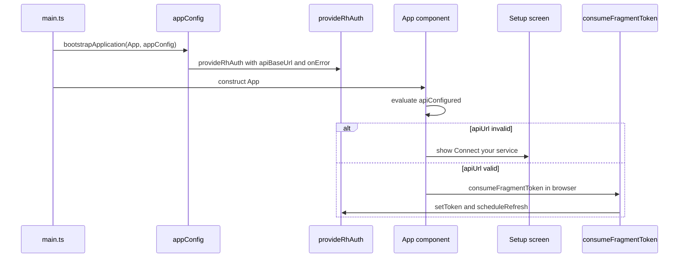
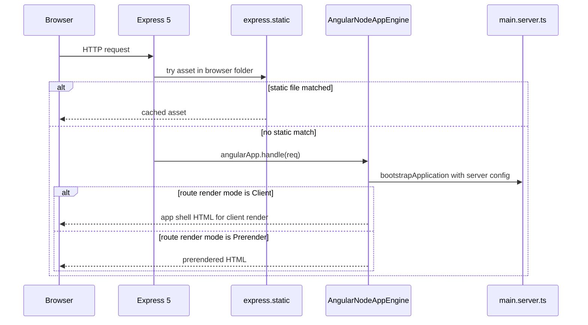

# Application Runtime and SSR

This page covers how the application runs: the dependency layers behind the runtime, the client and server bootstrap chains, hybrid SSR render modes, the Express 5 Node server, hydration, the connect-your-service screen, and the authenticated shell.

For route maps and guards see [Routing and Guards](routing-and-guards.md). For session and token semantics see [Auth Session](auth-session.md). For the 451 consents overlay see [Consents Gate](../concepts/consents-gate.md). Deployment commands live in the [Runbook](../operations/runbook.md).

## Dependency layers

The runtime sits on three layers. Templates and CSS are the disposable skin; Angular components hold framework glue (signals, forms, `RhAuthService` injection); `@ulabase/kit` plus its Angular adapter `@ulabase/kit-ng` own HTTP, bearer-token persistence, and session logic. Do not reimplement auth, HTTP, or token handling in app code — depend on the kit.

`@ulabase/kit-ng` bridges kit and Angular: `RhAuthService` (reactive session signals), `authGuard` / `publicGuard`, `provideRhAuth`, `setToken` / `scheduleRefresh`, and an HTTP interceptor that attaches the bearer token.

## Bootstrap chain

Browser entry is [`src/main.ts`](../../src/main.ts), which calls `bootstrapApplication(App, appConfig)`. `appConfig` in [`src/app/app.config.ts`](../../src/app/app.config.ts) is the single place that wires the runtime:

1. `isValidApiBaseUrl(environment.apiUrl)` decides whether routes exist at all (see [Connect your service](#connect-your-service)).
2. `provideRouter(activeRoutes)` registers those routes (or none).
3. `provideClientHydration(withEventReplay())` enables hydration with event replay.
4. `provideRhAuth({ apiBaseUrl: environment.apiUrl, onError: consentsOnError })` configures kit-ng — including the `onError` hook that raises the consents gate on HTTP 451.
5. `{ provide: TitleStrategy, useClass: AppTitleStrategy }` installs the document-title strategy used by the shell.

The server entry is [`src/main.server.ts`](../../src/main.server.ts). It exports a default `bootstrap` that calls `bootstrapApplication(App, config, context)` with a `BootstrapContext`. The server `config` in [`src/app/app.config.server.ts`](../../src/app/app.config.server.ts) is `mergeApplicationConfig(appConfig, serverConfig)`, where `serverConfig` adds `provideServerRendering(withRoutes(serverRoutes))`. Client and server therefore share `appConfig` (including `provideRhAuth`) and only differ by the server-rendering provider.

Bootstrap always installs `provideRhAuth` first; route registration and the fragment-token read are conditional on a valid `apiUrl` and the browser platform.

## Hybrid SSR render modes

Angular 21 hybrid SSR is declared in [`src/app/app.routes.server.ts`](../../src/app/app.routes.server.ts). Every `ServerRoute` there must mirror a real client route in [`src/app/app.routes.ts`](../../src/app/app.routes.ts), or SSR route extraction fails. Feature-flag conditionals on the server routes mirror the same flags on the client routes.

Render modes exactly as declared:

| Path | `RenderMode` | Gated by | Why |
|---|---|---|---|
| `auth/login` | `Prerender` | always | Static public page |
| `auth/signup` | `Prerender` | `emailRegistration \|\| oauthLogin` | Static public page |
| `auth/verify` | `Client` | `emailRegistration` | Calls `verify()` via API, then shows the result |
| `auth/forgot-password` | `Prerender` | `passwordReset` | Static public page |
| `auth/reset-password` | `Prerender` | `passwordReset` | Static public page |
| `auth/activate` | `Client` | `teamInvitations` | Reads the invitation and the current session on init |
| `invitations/accept` | `Client` | `teamInvitations` | Same page, second path |
| `''` (authenticated shell) | `Client` | always | Uses the browser-held token |
| `**` | `Client` | always | Catch-all |

So: public auth pages prerender where possible; `/auth/verify` and the two invitation paths are Client; the authenticated shell and `**` are Client.

**Key constraint:** the bearer token lives in browser `localStorage` (persisted by `@ulabase/kit-ng`), not in a cookie the server receives. Authenticated routes therefore cannot be server-rendered — the shell and everything under it are `RenderMode.Client`. SSR renders the public auth pages; client rendering takes over once the user is authenticated.

## Express 5 server and SSR request path

The build is hybrid server output (`angular.json`: `"outputMode": "server"`, browser entry `src/main.ts`, server entry `src/main.server.ts`, SSR entry `src/server.ts`). The SSR entry [`src/server.ts`](../../src/server.ts) is an Express 5 app:

1. `express.static(browserDistFolder)` serves built browser assets from `../browser` with `maxAge: '1y'`, `index: false`, `redirect: false`.
2. A catch-all middleware calls `angularApp.handle(req)` on an `AngularNodeAppEngine`. A returned response is written with `writeResponseToNodeResponse`; `null` falls through to `next()`.
3. The listener starts when the module is the main entry (`isMainModule`) or under PM2 (`process.env['pm_id']`), on `PORT` or default `4000`.
4. `export const reqHandler = createNodeRequestHandler(app)` exposes the same app to the Angular CLI dev-server, the build, or Firebase Cloud Functions.

The production run command is `node dist/ulabase-starter-ng/server/server.mjs` (npm script `serve:ssr:ulabase-starter-ng`) — see the [Runbook](../operations/runbook.md).

Static assets are answered before Angular runs; everything else goes through `AngularNodeAppEngine` and the server bootstrap in `main.server.ts`.

## Hydration

`appConfig` calls `provideClientHydration(withEventReplay())`. Prerendered public pages hydrate on the client without a full re-render, and event replay covers interactions that happen before hydration finishes. Client-rendered routes (shell, verify, invitations) do not rely on server HTML matching — they simply mount in the browser.

Browser-only APIs must stay behind platform checks. `App` guards `consumeFragmentToken` with `isPlatformBrowser`, and `ThemeService` only touches `localStorage` / `document` on the client.

## Connect your service

When `environment.apiUrl` is missing or not a valid Ulabase base URL (`isValidApiBaseUrl` is false):

- `appConfig` passes an empty route array to `provideRouter`, so the router never runs initial navigation or guards against a bad backend.
- [`src/app/app.html`](../../src/app/app.html) renders the "Connect your service" setup screen instead of `<router-outlet />`.
- `App` logs an error naming the bad `apiUrl` and which environment file to fix (`environment.dev.ts` for `ng serve`, `environment.ts` for production builds).

This is an invariant: invalid `apiUrl` ⇒ no routes ⇒ setup screen. The screen instructs the user to create a service, run `npx ulabase login` and `npx ulabase setup --srv <service id>`, then reload.

## Fragment token intake

On browser load with a valid `apiUrl`, `App` runs `consumeFragmentToken()` ([`src/app/app.ts`](../../src/app/app.ts)):

- It parses `#access_token=...` from the URL hash (the redirect target after email verification or OAuth), calls `setToken`, and `scheduleRefresh({ apiBaseUrl })`.
- It reads the one-shot `?flow=signup` query marker into the `justSignedUp` signal (welcome banner in the shell).
- It clears both the fragment and the `flow` marker via `history.replaceState` so they do not linger in browser history.

## Authenticated shell

Once `authGuard` admits a user, [`src/app/pages/shell/shell.ts`](../../src/app/pages/shell/shell.ts) owns the chrome around the inner router outlet:

- **Title strategy** — `AppTitleStrategy` (registered in `appConfig`) appends ` · Ulabase Starter` to the route title from `app.routes.ts`, or sets the bare suffix when a route has no title.
- **Progress bar** — a `navigating` signal is set on `NavigationStart` and cleared on `NavigationEnd` / `NavigationCancel` / `NavigationError`. While true, `shell.html` shows the top `nav-progress` bar, so lazy-loaded route chunks do not look like a frozen app.
- **Session chrome** — user initials, display name, active team name, theme toggle, and logout all read `RhAuthService` signals. The one-shot welcome banner consumes `justSignedUp` and then resets it.

The shell is only ever client-rendered (see the render-mode table), which is what lets it assume a browser-held token and inject `ThemeService` safely.

## Related pages

- [Auth Session](auth-session.md) — `RhAuthService` signals, `checkSession`, token lifecycle
- [Routing and Guards](routing-and-guards.md) — route map, `authGuard` / `publicGuard`, title suffix
- [Consents Gate](../concepts/consents-gate.md) — 451 overlay and `consentsOnError`
- [Runbook](../operations/runbook.md) — build, SSR serve, `PORT`, environment configuration
- [Source Map](../source-map.md) — file inventory for the entries above
