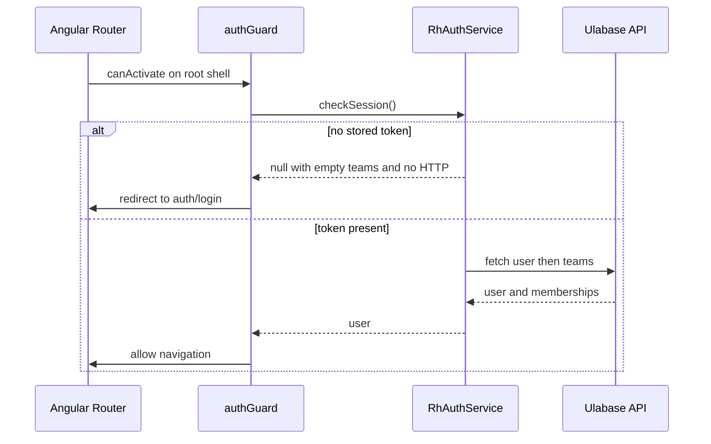
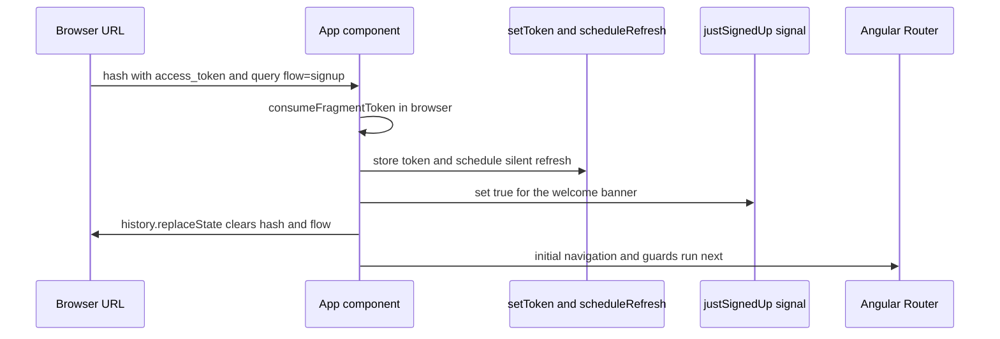
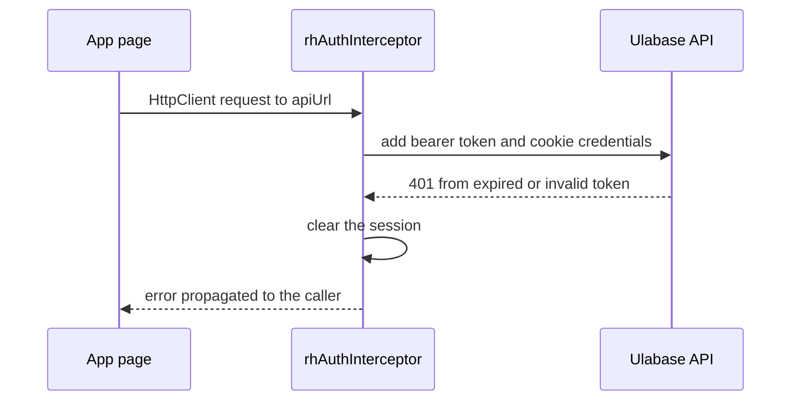

# Auth and Session Architecture

Auth and session behavior in this starter is split across two layers: `@ulabase/kit` (pulled in through the Angular adapter `@ulabase/kit-ng`) owns the bearer token and the HTTP session mechanics, while `RhAuthService` exposes session *state* to the app as signals. This page covers the storage/state split, the `RhAuthService` surface the app actually calls, how `authGuard` restores the session with `checkSession()`, how `consumeFragmentToken()` captures `#access_token` and `?flow=signup` before guards run, how the kit's HTTP interceptor handles `401`, and how to make authenticated API calls with `auth.api()`.

Route maps and guard placement live in [Routing and Guards](routing-and-guards.md). The 451 consents overlay is in [Consents Gate](../concepts/consents-gate.md). Entity shapes are in [Domain Model](../concepts/domain-model.md); the packages themselves are in [External Dependencies](../integrations/external-dependencies.md). End-to-end login, verification, and invitation sequences are in [Auth Flows](../workflows/auth-flows.md).

## Token storage versus session state

Keep the two layers distinct:

- **Kit persists the bearer token.** App code never assembles `Authorization` headers. It hands tokens to `setToken()`, reads them with `getToken()`, and starts silent renewal with `scheduleRefresh({ apiBaseUrl })`. A token that is not stored is treated as no session at all: `checkSession()` short-circuits without an HTTP call.
- **`RhAuthService` exposes state as signals.** Components read `user()`, `teams()`, and `isAuthenticated()` — the Angular-facing view of the session — and call the service methods that update those signals. Display logic never parses the token.

The split has an SSR consequence: the token is browser-side, so the server cannot see it. The authenticated shell is therefore `RenderMode.Client` in [`src/app/app.routes.server.ts`](../../src/app/app.routes.server.ts) — only the public auth pages can be prerendered.

## RhAuthService surface used by the app

Components inject `RhAuthService` from `@ulabase/kit-ng` and use it for every auth and team operation. The state and method contract is documented in [`PORTING.md`](../../PORTING.md); the call sites below show what the starter relies on:

| Concern | Surface | Call sites |
|---|---|--- |
| Session restore | `checkSession()` | `authGuard` (via guards), [`src/app/pages/account/account.ts`](../../src/app/pages/account/account.ts), [`src/app/pages/invitations/accept/accept.ts`](../../src/app/pages/invitations/accept/accept.ts) |
| Sign in / out | `login()`, `logout()` | [`src/app/pages/auth/login/login.ts`](../../src/app/pages/auth/login/login.ts), [`src/app/pages/shell/shell.ts`](../../src/app/pages/shell/shell.ts), [`src/app/consents-gate.ts`](../../src/app/consents-gate.ts) |
| Session signals | `user()`, `teams()`, `isAuthenticated()` | [`src/app/pages/home/home.ts`](../../src/app/pages/home/home.ts), `shell.ts`, [`src/app/pages/invitations/accept/accept.html`](../../src/app/pages/invitations/accept/accept.html) |
| Teams | `loadTeams()`, `switchTeam()` | [`src/app/pages/teams/teams.ts`](../../src/app/pages/teams/teams.ts), [`src/app/pages/teams/detail/team-detail.ts`](../../src/app/pages/teams/detail/team-detail.ts) |
| Custom API calls | `api()` | `home.ts` |
| Account, invitations, consents | `updateProfile()`, `changePassword()`, `verify()`, `getInvitation()`, `activate()`, `acceptInvite()`, `acceptConsents()`, … | account, verify, accept, and consents-gate components |

Standalone kit functions used outside the service: `provideRhAuth`, `isValidApiBaseUrl`, `authGuard`, `publicGuard`, `setToken`, `getToken`, `scheduleRefresh` (see [`src/app/app.config.ts`](../../src/app/app.config.ts), [`src/app/app.routes.ts`](../../src/app/app.routes.ts), [`src/app/app.ts`](../../src/app/app.ts)).

### Side effects of the session calls

These behaviors are easy to miss and are what team-dependent UI depends on:

- **`checkSession()` also loads teams.** With no stored token it short-circuits to `null` with empty teams and performs no HTTP; otherwise it fetches the user and then the teams. `home.ts` reads the active team without ever calling `loadTeams()` itself because `authGuard` already ran `checkSession()`.
- **`login()` also loads teams**, in the same round trip, so the shell is complete right after sign-in.
- **`loadTeams()` is the explicit refresh.** It updates the `teams()` signal and emits the memberships array; `team-detail.ts` reads the emitted list after `deleteTeam()` to decide whether another team must be activated.
- **`switchTeam()` reissues the bearer with a new active team** (`?delivery=body` returns `access_token` in the same response) and the session reflects the new team **without a page reload**.



Session restore on the authenticated shell: `authGuard` calls `checkSession()`, which loads the user and teams or redirects to login.

The same contract is why the unguarded invitation page restores the session by hand: [`src/app/pages/invitations/accept/accept.ts`](../../src/app/pages/invitations/accept/accept.ts) calls `checkSession()` whenever `getToken()` is truthy, because the route has no guard and the guards are what normally load the session.

## Fragment-token capture

After email verification and after OAuth, the backend 302-redirects the browser to the app with the token in the URL fragment (`#access_token=…&token_type=Bearer&expires_in=900`). On app start, `consumeFragmentToken()` in [`src/app/app.ts`](../../src/app/app.ts) — run in the `App` constructor on the browser platform only, before routing settles — must capture it before any guard runs:

1. Parse `window.location.hash`; if `access_token` is present, call `setToken(accessToken)` and `scheduleRefresh({ apiBaseUrl: environment.apiUrl })`.
2. Read `?flow=signup` — present only on the one redirect that follows a fresh signup (email verification *or* OAuth) — and raise the in-memory [`justSignedUp`](../../src/app/just-signed-up.ts) signal for the welcome banner.
3. Clear both the fragment and the `flow` param with `history.replaceState`, so neither lingers in browser history.



Fragment-token capture: `consumeFragmentToken()` stores `#access_token` and the `?flow=signup` marker before route guards run.

`justSignedUp` is never persisted. [`src/app/pages/shell/shell.ts`](../../src/app/pages/shell/shell.ts) copies the flag into a local signal and immediately resets the shared one, so the banner can appear exactly once per fresh signup and cannot reappear on a later login. Because the flag is raised for OAuth signups too, banner copy must not claim an email was verified.

## Authenticated API calls with `auth.api()`

For calls to your own collections on the Ulabase service, use `auth.api(endpoint)`. It is an authenticated `fetch` wrapper that attaches the session and returns an `Observable` of the `Response` (the home demo calls `res.json()`). A plain `fetch` carries no session and gets `401` — that is the most common "my request fails" mistake.

```typescript
this.auth.api('/demo').pipe(
  switchMap(res => res.json()),
  map(json => Array.isArray(json) ? json : []),
).subscribe();
```

`HttpClient` is equally valid for custom collections: the kit's `rhAuthInterceptor` applies the session to every `HttpClient` request bound for `apiUrl`, so no header needs to be attached by hand. Use `auth.api()` for simple authenticated calls; reach for `HttpClient` when you need explicit interceptors or request configuration.

## Interceptor and 401 handling

`provideRhAuth({ apiBaseUrl, onError })` registers the kit's `rhAuthInterceptor` (see [`NOTES.md`](../../NOTES.md)). For every `HttpClient` request bound for `apiUrl` it applies the bearer token, the challenge suppression that keeps the browser's Basic Auth popup away on a `401`, and cookie credentials. Requests to any other host pass through untouched — the token is a credential and must not be handed to third parties.

On `401` or token expiry the HTTP layer **clears the session**, signing the user out rather than leaving them with a hanging or silently failing UI. This is distinct from a `401` returned by an *auth attempt* (wrong password on `login()`, invalid reset token, and so on), which is surfaced to the calling component as an error message and does not itself imply an existing session.



Interceptor 401 handling: `rhAuthInterceptor` attaches the session to `apiUrl` requests and clears it when the service answers `401`.

The bearer has a **15-minute TTL** and `scheduleRefresh()` silently renews it at about 80% of that (~12 minutes). Session-restore failures have no caller to observe them, so `provideRhAuth`'s `onError` hook is what sees them — that is how the consents gate distinguishes "blocked by 451" from "signed out" (see [Consents Gate](../concepts/consents-gate.md)).

## Versions

`package.json` declares `@ulabase/kit-ng` and `@ulabase/cli` at `^0.15.0`; `package-lock.json` resolves `@ulabase/kit-ng`, `@ulabase/kit`, and `@ulabase/cli` to `0.15.0`. Treat the lockfile as the source of truth for the installed kit, and `package.json` for the declared range.

## Focused tests

`TEST-CASES.md` carries the session invariants worth checking by hand: reload after login keeps the session; idle past ~12 minutes silently renews via `GET /token?renew`; `POST /auth/switch-team?delivery=body` reflects the new team without a reload; and an expired or invalid token clears the session on the next API call instead of hanging.
