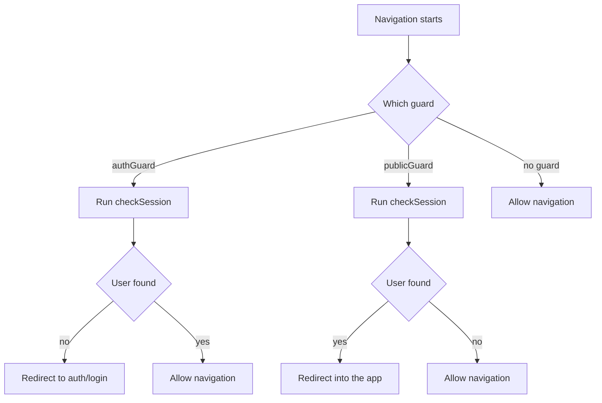

# Routing, Guards, and Feature Flags

This page documents the route surface of the starter: how [`src/app/app.routes.ts`](../../src/app/app.routes.ts) builds the client route table, how `environment.features` flags conditionally include routes, what `authGuard` and `publicGuard` do on navigation, the deliberately unguarded dual-path invitation route, and how [`src/app/app.routes.server.ts`](../../src/app/app.routes.server.ts) must mirror the client table for hybrid SSR. For session and token semantics see [Auth Session](auth-session.md); for bootstrap and SSR request handling see [Application Runtime and SSR](app-runtime.md).

## Route map

Public auth screens are top-level routes. Everything else is a child of the `Shell` component at `path: ''`, which is protected by `authGuard`. The catch-all `**` redirects to `''`, so unknown URLs land on the authenticated home (or the login redirect).

| Path | Title | Guard | Feature flag |
|---|---|---|---|
| `auth/login` | Log in | `publicGuard` | always |
| `auth/signup` | Create an account | `publicGuard` | `emailRegistration \|\| oauthLogin` |
| `auth/verify` | Verifying your email | `publicGuard` | `emailRegistration` |
| `auth/forgot-password` | Forgot password | `publicGuard` | `passwordReset` |
| `auth/reset-password` | Set a new password | `publicGuard` | `passwordReset` |
| `auth/activate`, `invitations/accept` | Accept invitation | none | `teamInvitations` |
| `''` (Shell) | — | `authGuard` | always |
| ` └ home` | Home | inherited | always |
| ` └ teams` | Teams | inherited | always |
| ` └ teams/new` | New team | inherited | always |
| ` └ teams/:id` | Team | inherited | always |
| ` └ account` | Account | inherited | always |
| `**` | — | — | redirects to `''` |

Child routes inherit `authGuard` from the shell parent, so every authenticated screen requires a session.

## Feature flags gate routes and UI

The flags live in `environment.features` in [`src/environments/environment.ts`](../../src/environments/environment.ts) (production) and [`src/environments/environment.dev.ts`](../../src/environments/environment.dev.ts) (dev server). They must match the **Sign-up Mgmt → Features** toggles of the linked Ulabase service: a feature that is off server-side returns `403` to unauthenticated users, so the app must not offer UI or routes for it.

| Flag | Routes it includes | UI it also gates |
|---|---|---|
| `emailRegistration` | `auth/signup` (with `oauthLogin`), `auth/verify` | Email form on signup; "Create an account" link on login |
| `passwordReset` | `auth/forgot-password`, `auth/reset-password` | "Forgot password?" link on login |
| `oauthLogin` | `auth/signup` (with `emailRegistration`) | OAuth buttons on login and signup |
| `teamInvitations` | `auth/activate`, `invitations/accept` | Accept-invitation page (see below) |

`auth/signup` is included when **either** `emailRegistration` or `oauthLogin` is true (`emailRegistration || oauthLogin`); `auth/verify` requires `emailRegistration` alone.

A disabled flag removes **both** the route and the corresponding UI. Routes are included by spreading a conditional array into `routes` in [`src/app/app.routes.ts`](../../src/app/app.routes.ts); templates use the same flags (`login.html`, `signup.html`) to hide links and forms. The home page capability list still shows disabled features but marks them `off` — that list is a status display, not an entry point.

`oauthProviders` is not a gate; it is the provider list passed to `OauthButtons` and must match what is configured server-side.

## Guard redirects

`authGuard` and `publicGuard` come from `@ulabase/kit-ng` and are the only two guards in the app. Guard evaluation is what normally loads the session: `authGuard` runs `checkSession()`, which restores the user and (as a side effect) loads team memberships, so authenticated pages can rely on `auth.teams()` being populated after navigation.

- **`authGuard`** — applied to the shell root. If `checkSession()` finds no user, navigation is cancelled and the router redirects to `/auth/login`. If a user is found, navigation proceeds.
- **`publicGuard`** — applied to every auth screen (`auth/login`, `auth/signup`, `auth/verify`, `auth/forgot-password`, `auth/reset-password`). The inverse: if a user **is** already signed in, the router redirects into the app so a signed-in user cannot land on a login or signup form.

Guard decision flow: `authGuard` sends signed-out users to `/auth/login`; `publicGuard` sends signed-in users away from auth pages.

When `apiUrl` is missing or not a valid Ulabase URL, [`src/app/app.config.ts`](../../src/app/app.config.ts) registers an **empty route table** (`activeRoutes = []`). No guard ever runs against a missing backend; the app renders the "connect your service" screen instead. This prevents a confusing network error from `authGuard`'s `checkSession()` on first run.

## The unguarded dual-path invitation route

Under `teamInvitations`, [`src/app/app.routes.ts`](../../src/app/app.routes.ts) registers **the same `Accept` component at two paths**: `auth/activate` and `invitations/accept`. The service's invitation email links a *new* user to `/auth/activate` and an *existing* user to `/invitations/accept`. Both paths are **deliberately unguarded** — the invitee may be signed out, signed in, or have no account yet, and a guard would reject one of those cases.

Because no guard runs, the `Accept` component restores the session by hand: [`src/app/pages/invitations/accept/accept.ts`](../../src/app/pages/invitations/accept/accept.ts) calls `auth.checkSession()` whenever `getToken()` is truthy, so a user returning from the consents gate sees "Join team" rather than a login form. It then fetches the invitation via `getInvitation(email, token)` and offers three outcomes: set a password and `activate()` (new user), log in and `acceptInvite()` (existing user), or — if the invitation is already used and a session exists — redirect into the app.

This dual-path, unguarded design is the current contract. Earlier documentation that described a single invitation path is stale.

## SSR mirror constraint

[`src/app/app.routes.server.ts`](../../src/app/app.routes.server.ts) declares a `ServerRoute` for every client route and nothing more. **Every entry there must match an actual client route, or Angular's SSR route extraction fails the build.** The same `environment.features` flags gate the same conditional blocks on both sides — if `app.routes.ts` omits `auth/verify` because `emailRegistration` is false, `app.routes.server.ts` must omit it too.

| Path | `RenderMode` | Gated by | Why |
|---|---|---|---|
| `auth/login` | `Prerender` | always | Static public page |
| `auth/signup` | `Prerender` | `emailRegistration \|\| oauthLogin` | Static public page |
| `auth/verify` | `Client` | `emailRegistration` | Calls `verify()` via API, then shows the result |
| `auth/forgot-password` | `Prerender` | `passwordReset` | Static public page |
| `auth/reset-password` | `Prerender` | `passwordReset` | Static public page |
| `auth/activate` | `Client` | `teamInvitations` | Reads the invitation and session on init |
| `invitations/accept` | `Client` | `teamInvitations` | Same page, second path |
| `''` (shell) | `Client` | always | Uses the browser-held token |
| `**` | `Client` | always | Catch-all |

Both invitation paths are `RenderMode.Client`: the component makes live API calls on init and reads browser-side session state, so it cannot be prerendered or server-rendered on request. The authenticated shell is likewise `Client` because the bearer token lives in `localStorage`, not in a cookie the server receives.

## Per-route titles

Every route carries a `title` string. `AppTitleStrategy` in [`src/app/app.routes.ts`](../../src/app/app.routes.ts) extends Angular's `TitleStrategy` and appends a fixed suffix: the document title becomes `"<Route title> · Ulabase Starter"`, or just `Ulabase Starter` when no route title is set. The strategy is installed in [`src/app/app.config.ts`](../../src/app/app.config.ts) via `{ provide: TitleStrategy, useClass: AppTitleStrategy }`.

## Test coverage

There is no dedicated unit test for the route table or guard wiring; `src/app/app.spec.ts` only asserts the root component constructs. Guard and route behavior is exercised end-to-end through the component specs under `src/app/pages/` and manual verification (see [Testing Guidance](../testing/guidance.md)). When adding a route, verify it appears in **both** `app.routes.ts` and `app.routes.server.ts` — a mismatch fails the SSR build rather than a unit test.

## Related pages

- [Application Runtime and SSR](app-runtime.md) — bootstrap chain, `provideRouter`, Express server
- [Auth Session](auth-session.md) — `checkSession()` side effects, token storage, fragment capture
- [Domain Model](../concepts/domain-model.md) — `Invitation`, `TeamMembership` shapes
- [Auth Flows](../workflows/auth-flows.md) — end-to-end login, verification, invitation sequences
- [Teams and Invitations](../workflows/teams-and-invitations.md) — invite, accept, and team-management workflows
- [Testing Guidance](../testing/guidance.md) — how routing and guard behavior is covered by tests
