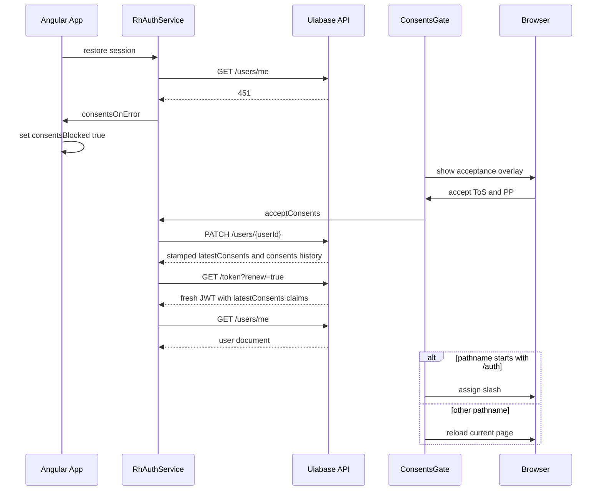

# Consents Gate

The consents gate is a **server-enforced** requirement that every signed-in user accept the current Terms of Service and Privacy Policy before the API will serve them. Enforcement lives as a Ulabase **Guards** rule that answers HTTP `451 Unavailable For Legal Reasons`; the Angular starter only reacts to that status code with a blocking overlay and an acceptance call. The rule therefore also applies to mobile clients, `curl`, and any other API integration — not just to this app.

The gate is installed by [`ulabase.setup.consents.ts`](../../ulabase.setup.consents.ts). The client half lives in [`src/app/consents.ts`](../../src/app/consents.ts) and [`src/app/consents-gate.ts`](../../src/app/consents-gate.ts). There is nothing to probe on load and no client collection to create: `/users/me` is one of the requests the rule blocks, so session restore itself is what trips the gate.

Without the gate documents on the service, no request is ever answered `451`, the signal stays down, and the overlay never renders. An unasked question is the absence of a rule on the server, not a flag in the app.

Related: [Auth Session](../architecture/auth-session.md) for token and session lifecycle, [Domain Model](domain-model.md) for the user document, [Runbook](../operations/runbook.md) and [Service Setup](../workflows/service-setup.md) for provisioning, and [Teams and Invitations](../workflows/teams-and-invitations.md) for the invitation flow the post-accept navigation preserves.

## Server side

`ulabase.setup.consents.ts` is `ulabase.setup.ts` with four documents appended. It imports the accounts steps (minus `appPointsAtService`, which stays last) so the accounts definition has one home and cannot drift. Apply it with:

```bash
ulabase setup --srv <srvId> --file ulabase.setup.consents.ts
```

### User schema (`userConsentsSchema`)

Stored at `/schemas/userConsentsSchema` and bound to the `users` collection via `/users/_meta`. It adds two fields:

- `latestConsents` — an object with `tos`, `pp`, and `acceptedAt` (a BSON date, written in the schema as the escaped type key `_$date` so the parser does not read it as a value while the schema is being stored). `tos` and `pp` are required inside the nested object.
- `consents` — a history array of past acceptances.

Only `_id` and `roles` are required on the user document. Demanding `latestConsents`, `consents`, password, profile, or team fields would reject every registration and every invitation: invited users are written with no password and an empty profile, and the document is validated as it is inserted, before the initial team is attached.

One consequence: `_id` **is** required, and on a `PUT /users/{id}` it arrives in the path rather than the body, so a direct write is refused with `required key [_id] not found`. Registration through `/auth/register` sends a whole document and passes. Setup-file `createUser` calls and hand-made users need the id in the body too.

### Permission (`userCanPatchOwnConsents`)

Without this permission the acceptance is a `403` and the user is locked out for good: nothing authorises `PATCH /users/{userId}` out of the box, and a Guards rule never gets a say on a request the ACL already refused.

The permission allows `user` to `PATCH /users/{userId}` when the path id is their own (`equals(@user._id, ${userId})` or `equals(@user.sub, ${userId})`) and the body whitelists only `consents` (`bson-request-whitelist(consents)`).

The server decides what is accepted. The client sends `{"consents": []}` and states nothing about versions — otherwise it could accept terms it was never shown or backdate an acceptance. The permission's `mergeRequest` stamps both documents and grows the history:

```ts
mergeRequest: {
  latestConsents: { tos: TOS_VERSION, pp: PP_VERSION, acceptedAt: '@now' },
  _$push: { consents: { tos: TOS_VERSION, pp: PP_VERSION, acceptedAt: '@now' } },
}
```

`latestConsents` is written as a nested object, never dotted keys: a request that sets both a field and a path inside it is refused by MongoDB with `ConflictingUpdateOperators`. `$push` is escaped (`_$push`) inside the stored config and unescaped before the merge so the history grows instead of being overwritten.

### JWT claims

The setup appends `latestConsents/tos` and `latestConsents/pp` to the `auth` feature's `account-properties-claims` (added, not replaced — a service may carry claims of its own). The Guards rule reads the **token**, not the database, so the gate evaluates without a database round-trip per request.

A missing claim compares false for every token-authenticated user for ever — including the ones who just accepted — and blocks them permanently while the condition looks perfectly reasonable. Only these two claims are published: a JWT payload is base64, not encrypted, so everything in it is readable by anyone holding the token; the `consents` history in particular grows at every acceptance and no decision reads it.

### Guards rule (`consentsGate`)

After installing the `guards` feature, a rule blocks with status `451` when *either* current version is missing from the token claims — `not (A and B)`, never `not A and not B`, which would block only the users who accepted neither. The condition is joined with `and`:

1. `equals(@authenticated, 'true')` — anonymous callers are excluded with the RESTHeart 9.8 built-in `@authenticated`, not by naming every public path. A hand-kept public-path list was invisible until it was wrong (it missed a shop catalogue and `/stripe/webhook`).
2. `not path-prefix('/auth')` and `not path-prefix('/token')` — signing in and fetching a token are authenticated requests made by someone who has not accepted yet. Guard those and a blocked user cannot get back in — you included.
3. `not (method(PATCH) and path-template('/users/{userId}') and bson-request-whitelist(consents))` — the acceptance itself, made while still blocked.
4. `not (equals(@user.latestConsents.tos, '${TOS_VERSION}') and equals(@user.latestConsents.pp, '${PP_VERSION}'))` — the actual gate.

`/users/me` is deliberately **not** excluded. Blocking it is what makes the gate work with no probing on the client's side.

The rule sets `action: 'block'`, `status_code: 451`, a human-readable message, and `on_error: 'allow'` — a rule that cannot be evaluated must not lock everyone out. The setup check compares the rule's full condition, not merely its presence, so a version bump shows up as work outstanding.

## Client side

### Raising the flag

[`src/app/consents.ts`](../../src/app/consents.ts) is a plain module, not a service: `onError` is handed to `provideRhAuth` while the injector is still being built, and signals work outside DI.

- `consentsBlocked` — module-level signal that drives the overlay.
- `consentsOnError(err)` — sets the signal on any `451` from the service.

[`src/app/app.config.ts`](../../src/app/app.config.ts) wires it in as `provideRhAuth({ apiBaseUrl: environment.apiUrl, onError: consentsOnError })`. Session restoration happens on its own schedule and `authGuard` absorbs its failures, so this hook is the only place that gets to see why it failed — without it, "blocked" and "signed out" are the same thing to the app.

### The overlay

`ConsentsGate` ([`src/app/consents-gate.ts`](../../src/app/consents-gate.ts), template [`src/app/consents-gate.html`](../../src/app/consents-gate.html)) is mounted in [`src/app/app.html`](../../src/app/app.html) at the root, **outside** `<router-outlet>`. That placement is the point: a blocked user has no session — `/users/me` is refused too — so `authGuard` fails and the navigation is cancelled. Nothing inside the outlet ever renders, which is exactly why the gate cannot live there.

Two checkbox signals (`acceptedTos`, `acceptedPp`) gate the Accept button and nothing else. The request that follows carries no versions. On success the component calls `auth.acceptConsents()` — the kit PATCHes the acceptance, renews the token (`GET /token?renew=true`), reloads the user document, and updates the service's `user` signal. The renewal is not optional: a JWT is a snapshot, and without a fresh one the rule keeps blocking the user for the whole life of the token they hold.

Post-accept navigation is pathname-aware:

- on `/auth` paths, `window.location.assign('/')` — the user came from login or signup and should land in the app;
- otherwise, `window.location.reload()` — stay on the same page, signed in, so an in-progress flow (such as [invitation acceptance](../workflows/teams-and-invitations.md)) is not lost.

A full reload is used rather than a router navigation because the guard already cancelled the one that brought the user here; re-entering with a new token and a readable user document is simpler than replaying a failed navigation. It happens once, per user, ever.

`signOut()` clears `consentsBlocked` before logging out (the signal outlives the session) so the next user on the same tab does not meet the overlay before making a single request. There is no close button and no backdrop dismissal: the only ways out are accepting or signing out.

### Session restore through acceptance



*Session restore trips the Guards rule, the overlay collects acceptance, and the kit stamps, renews, and reloads before pathname-aware navigation.*

## Invariants

- **The overlay is UX, not enforcement.** Remove it with the dev tools and every request still comes back `451`. The rule lives on the server.
- **The client never knows document versions.** Nothing in the app names which ToS or Privacy Policy revision is current; the permission's `mergeRequest` stamps them server-side. Bumping versions needs no client change and no redeploy.
- **The acceptance request states nothing about what is accepted.** The user id comes from the token (the user document is exactly what cannot be read yet), and versions and timestamp are stamped by the permission.
- **Post-accept navigation is pathname-aware.** `/auth` paths go to `/`; anything else reloads in place so in-progress flows survive.
- **`on_error: 'allow'`.** A rule that cannot be evaluated must not lock everyone out.

## Version bump

Document versions live in one place — `TOS_VERSION` and `PP_VERSION` at the top of [`ulabase.setup.consents.ts`](../../ulabase.setup.consents.ts) — and everything else is derived. In the hand-written console walkthrough the two version strings appear four times (twice in the permission's `mergeRequest`, twice in the rule's condition) and must agree exactly; the failure when they do not is quiet, and a user is blocked for ever by a form that says it worked.

To publish new documents:

1. Change `TOS_VERSION` and/or `PP_VERSION` in [`ulabase.setup.consents.ts`](../../ulabase.setup.consents.ts).
2. Re-run `ulabase setup --srv <srvId> --file ulabase.setup.consents.ts`. The rule and the permission's `mergeRequest` move together; the setup check compares the full condition so the bump shows up as work outstanding.
3. Update the `Version 2026-07-01` line in [`public/terms.html`](../../public/terms.html) and [`public/privacy.html`](../../public/privacy.html) — the only place left to keep in step by hand.

Every user meets the acceptance form again on their next request; prior acceptances stay in the `consents` history.

The legal documents themselves are plain static HTML in `public/`, not app routes: a blocked user has no session, so anything routed through the app would sit behind the gate they are trying to read their way out of. They are placeholders — replace them.

## Extension points and operations

- **Mid-session 451s.** The starter makes no data requests of its own, so `consentsOnError` is enough. If your own `HttpClient` calls should raise the flag too (say the terms change while someone is mid-session), add an interceptor that calls `consentsBlocked.set(true)` on a `451`.
- **Setup without the gate.** Set the service up with `ulabase.setup.ts` and the client code is still present; no rule exists, so no request is ever `451` and the overlay never opens.
- **Focused tests.** There is no dedicated unit spec for the gate; the repo treats it as a manual `451` test (simulate a blocked user after setup and verify overlay, acceptance, and sign-out). See [Runbook](../operations/runbook.md) for the operational picture.
