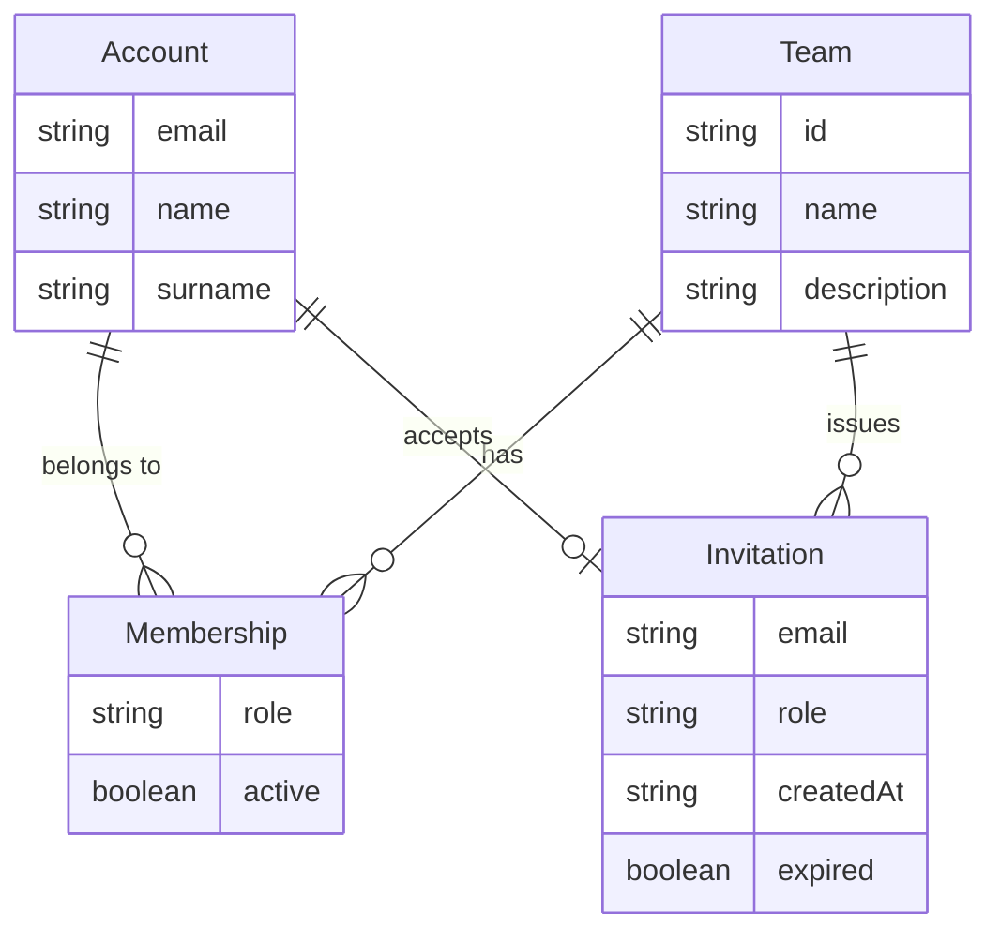
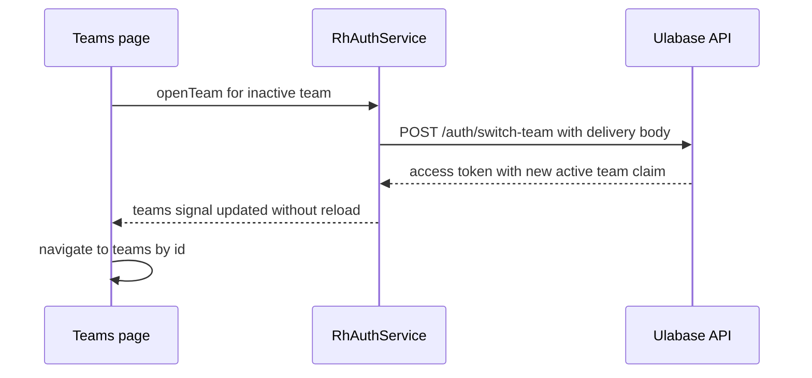
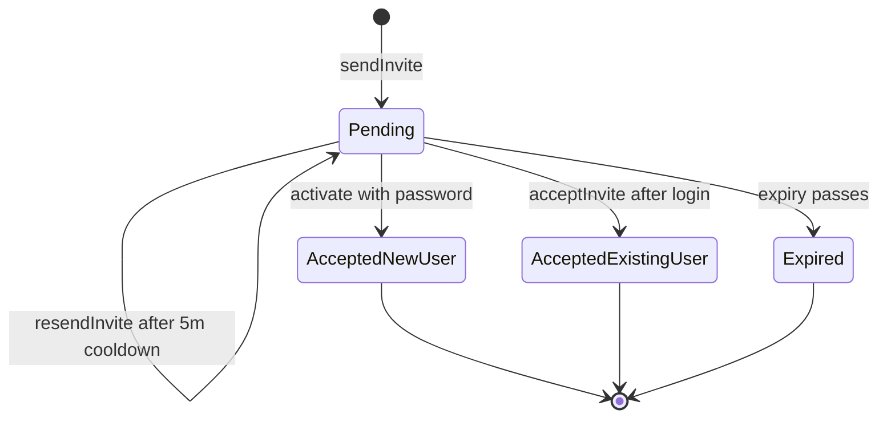

# Domain Model

This page defines the entities the starter reads and writes, the invariants that hold across the
client and the Ulabase service, and the lifecycle of the one transient state the app owns itself.
Session mechanics live in [Auth Session](../architecture/auth-session.md); route placement of the
invitation page is in [Routing and Guards](../architecture/routing-and-guards.md); the consents
document attached to each user is in [Consents Gate](consents-gate.md).

## User and profile

A user is identified by **email**: `user._id` **is the email address**. Ulabase uses email as the
user id, so there is no separate username or numeric key to map. The display name is not on `_id` —
it lives in a nested `profile` object at `user.profile.name` and `user.profile.surname`. The shell
reads both and falls back to `_id` when the profile is empty, which is the normal state for a
freshly invited user (see
[`src/app/pages/shell/shell.ts`](../../src/app/pages/shell/shell.ts)):

- `displayName()` joins `profile.name` and `profile.surname`, falling back to `user._id`.
- `initials()` takes the first character of each name part, falling back to the first character of
  `_id`.
- `email()` returns `user._id` directly — the account email.

Invited users are written with **no password and an empty profile**; the profile is filled when the
invitation is accepted. The consents schema therefore requires only `_id` and `roles` on the user
document — demanding password, profile, or team fields would reject every registration and every
invitation (see [Consents Gate](consents-gate.md)).

## Teams and membership

A team is a multi-tenant container. Each user belongs to one or more teams through a
`TeamMembership`. The `teams()` signal on `RhAuthService` holds the caller's own memberships —
not a team's member list. Each entry carries `id.$oid`, `name`, `description`, `role`, and `active`
(see [`PORTING.md`](../../PORTING.md)):

| Field | Meaning |
|---|---|
| `id` | MongoDB ObjectId wrapper. Navigate with `id.$oid`; pass the whole `id` object to `switchTeam()`. |
| `name` | Display name. |
| `description` | Optional free text. |
| `role` | The caller's role in this team: `owner` or `member`. |
| `active` | Whether this is the user's currently active team. |

`TeamMember` is a different shape — a row in the active team's member list. The service's
`GET /auth/team/members` returns `[{ email, name, role, joinedAt }]` for the caller's active team,
joining `teams.members[].userId` against `users.profile`. The app never removes the signed-in user
from their own team: the row shows the role instead of a remove action.

Entity relationships: an account holds memberships, a team owns memberships and issues invitations,
and an invitation is accepted by an account. The account's `email` attribute is `user._id`.

### Roles

Roles are `owner` or `member`, scoped to a team. Owner-gated operations — invite, resend invite,
remove member, change role, rename, delete — are shown only when `team()?.role === 'owner'`
(`isOwner()` in
[`src/app/pages/teams/detail/team-detail.ts`](../../src/app/pages/teams/detail/team-detail.ts)),
and the service enforces the same restriction server-side: `invite`/`resendInvite`,
`removeMember`, and `updateMemberRole` are owner/admin only. Owners cannot remove themselves.

### Team lifecycle

Registration creates a team automatically. The name is `"<firstName>'s Team"` when a first name is
present, else `"<email-local-part>'s Team"` (see
[`src/app/pages/auth/signup/signup.ts`](../../src/app/pages/auth/signup/signup.ts)). Additional
teams are created via `auth.createTeam(name)`, which assigns the caller as `owner` and reissues the
JWT with the new team active.

Deletion is refused unless the team has no other members: the service enforces this atomically
(`findOneAndDelete` with an `$expr` size guard) and returns **409** when other members remain. The
client surfaces the server's message. After a successful delete, the app reloads the memberships
and — if teams remain but none is active — switches to the first remaining team before navigating
back to the team list (see `deleteTeam()` in
[`src/app/pages/teams/detail/team-detail.ts`](../../src/app/pages/teams/detail/team-detail.ts)).

## Active team and the JWT claim

The active team travels in the **JWT `team` claim**, shaped `{ _id, role }` — the same shape as
`user.team` on the database document. The claim is what authorises team-scoped requests; the
`teams()` signal is what the UI reads.

`switchTeam(team.id)` reissues the bearer with a different active team. The call goes out as
`POST /auth/switch-team?delivery=body`, which returns the new `access_token` **in the same
response** — no follow-up `POST /token`. The session reflects the new team **without a page
reload**. `openTeam()` in
[`src/app/pages/teams/teams.ts`](../../src/app/pages/teams/teams.ts) short-circuits when the team
is already active and otherwise switches, then navigates to `/teams/:id`.

Token delivery is always bearer mode: `activate`, `reset-password`, and `switch-team` are called
with `?delivery=body` and return the token in the body. A correct port never issues a follow-up
token request after these calls.

Team switch: `switchTeam()` reissues the JWT active-team claim and the session updates without a page reload.

## Invitations

An invitation links an **email** to a **team** with a target **role**. The service emails two links
— `/auth/activate` for a brand-new user, `/invitations/accept` for an existing account — both routed
to the same `Accept` component and gated by the `teamInvitations` feature flag. Each link carries
`email` and `token` as **query parameters**; both are required. Missing either shows the
"invalid invitation link" panel (`missingParams` in
[`src/app/pages/invitations/accept/accept.ts`](../../src/app/pages/invitations/accept/accept.ts)).

### Accept lifecycle

The component calls `getInvitation(email, token)` on init and branches on `invitation().isNewUser`.
Three outcomes cover every case:

1. **New user** — set a password and `activate({ email, token, password })`. The user is created,
   joined to the team, and logged in directly.
2. **Existing user, signed out** — log in with `loginForm`, then `acceptInvite(token)`.
3. **Existing user, signed in** — one click on "Join team" calls `acceptInvite(token)`.

The route has no guard, so the component restores the session by hand: `checkSession()` runs
whenever `getToken()` is truthy, so a user returning from the consents gate sees "Join team" rather
than a login form.

Invitation lifecycle: a pending invitation can be resent after the cooldown, activated by a new
user, accepted by an existing user, or expire.

### Pending invitation shape

`listInvitations()` returns `PendingInvitation` rows: `email`, `role`, `expired`, and `createdAt`.
`createdAt` is the time of the **last send**. The team-detail template marks `expired` rows and
offers a Resend button on active ones.

### Resend cooldown

The service refuses a resend within **5 minutes** of an invitation's last send. The client mirrors
this limit in `TeamDetail` as `RESEND_COOLDOWN_MS = 5 * 60 * 1000` and keeps a per-email cooldown
map:

- **Seeding.** When the pending list loads, `withLastSends()` records each non-expired invitation's
  `createdAt` (parsed and kept when later than the value already known), so the countdown starts
  from the real last send rather than from page load.
- **Restart.** A successful `resendInvite()` stamps `Date.now()` into both the cooldown map and the
  `now` signal, so the countdown begins at a clean 5m instead of rounding up against a stale tick.
- **Live countdown.** The app is zoneless, so `Date.now()` is not a reactive source. A `now` signal
  ticks every **30 seconds** (`interval(30_000)`), which keeps the "Wait Nm" label and the disabled
  button accurate without a full second-resolution timer.
- **Server refusals.** A refused resend surfaces the service's reason (too many resends, or too
  soon) through `resendError`, not a generic failure message.

### Invitation 404 handling

If `getInvitation()` returns **404** and the user has a token, the component navigates to `/`
instead of showing "invalid link". This handles the case where a signed-in user revisits an
already-accepted invitation link after the consents gate reloads the page. A 404 with **no**
session is a genuine invalid-or-expired link and shows the error message.

## Feature flags

Feature flags live **once** in `src/environments/environment*.ts` and must match the
"Sign-up Mgmt → Features" toggles of the Ulabase service. A feature that is off on the server
returns **403** to unauthenticated users, so leaving the UI visible produces dead ends. The flags
are:

| Flag | Service toggle | Gates |
|---|---|---|
| `emailRegistration` | Registration and Verification | signup and verify routes |
| `passwordReset` | Password Reset | forgot/reset password routes |
| `oauthLogin` | Google sign-in | OAuth buttons |
| `oauthProviders` | OAuth client list | which providers to offer |
| `teamInvitations` | Team Invitations | `auth/activate` and `invitations/accept` routes |

The setup tooling derives the server toggles **from the same file**:
`ulabase.setup.ts` reads `environment.features` and maps
`registration`/`verification` from `emailRegistration`, `password-reset` from `passwordReset`,
`invitations` from `teamInvitations`, and `oauth` from `oauthLogin`. The flags are stated once —
turning a toggle off in the app and re-running setup turns it off on the service too. Routes are
built from the same flags in
[`src/app/app.routes.ts`](../../src/app/app.routes.ts), so a flag that is false removes the route
entirely.

## The justSignedUp signal

`justSignedUp` is a module-level Angular signal in
[`src/app/just-signed-up.ts`](../../src/app/just-signed-up.ts) — **true for exactly one page load
after a fresh signup**, whether that signup came from email verification or OAuth. It is never
persisted.

`consumeFragmentToken()` in
[`src/app/app.ts`](../../src/app/app.ts) raises it from the `?flow=signup` query parameter, which
the backend includes only on the one-time redirect that follows a fresh signup. The same function
captures the `#access_token` fragment, then clears both the fragment and the `flow` param with
`history.replaceState` so neither lingers in browser history.

The Shell copies the flag into a local signal in its constructor and immediately resets the shared
one to `false`. This is what makes the welcome banner one-shot: the global signal can never be read
true again on a later login in any browser. Because the flag is raised for OAuth signups too, the
banner copy must not claim an email was verified.

## Related pages

- [Auth Session](../architecture/auth-session.md) — token storage, `RhAuthService` signals, and `checkSession()`
- [Routing and Guards](../architecture/routing-and-guards.md) — where the invitation routes and guards sit
- [Consents Gate](consents-gate.md) — the user-document schema and the 451 overlay
- [Service Setup](../workflows/service-setup.md) — provisioning the service from `environment.features`
- [Teams and Invitations](../workflows/teams-and-invitations.md) — end-to-end team and invitation flows
