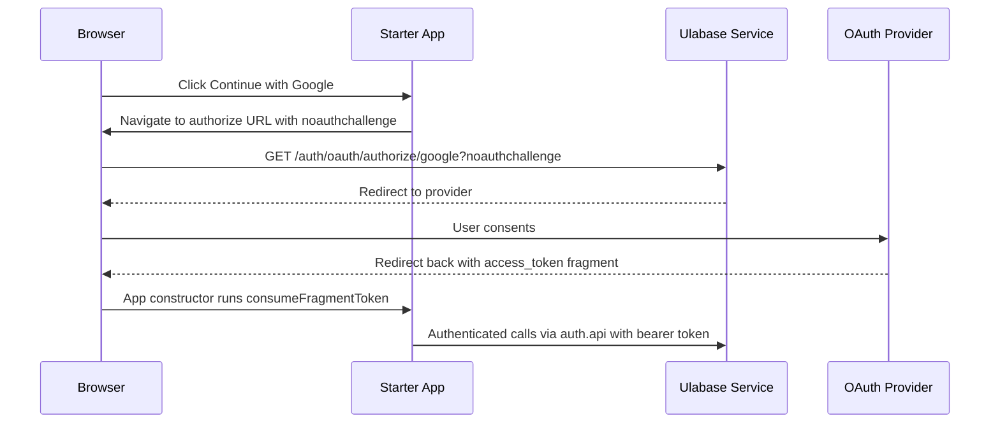

# External Dependencies and Integrations

This page covers the external packages and tooling the starter integrates with: the Ulabase auth stack (`@ulabase/kit`, its Angular adapter `@ulabase/kit-ng`, the Ulabase service API, OAuth providers), the `@ulabase/cli` service-provisioning tool, and repository tooling — chiefly the OpenWiki CI workflow. Session and token semantics are in [Auth and Session Architecture](../architecture/auth-session.md); end-to-end login and invitation sequences are in the auth flows workflow; service provisioning detail lives with the setup files.

## Declared versus resolved versions

**Invariant:** `package.json` declares the *range*; `package-lock.json` is the source of truth for what is *installed*. Never conflate the two.

| Package | Declared (`package.json`) | Resolved (`package-lock.json`) |
|---|---|---|
| `@ulabase/kit-ng` | `^0.15.0` (dependency) | `0.15.0` |
| `@ulabase/kit` | (transitive via kit-ng and cli) | `0.15.0` |
| `@ulabase/cli` | `^0.15.0` (devDependency) | `0.15.0` |

The lockfile pins `@ulabase/kit` at `0.15.0` underneath both `@ulabase/kit-ng` and `@ulabase/cli`. `@ulabase/kit-ng` also declares peer dependencies on `@angular/common`, `@angular/core`, `@angular/router` (all `>=21`) and `rxjs` (`>=7`), matching the Angular 21 starter. `@ulabase/cli` exposes the binaries `ula` and `ulabase` (both `dist/cli.js`).

## The Ulabase kit stack

The auth stack is split across two npm packages plus the remote service:

- **`@ulabase/kit`** — plain TypeScript, Promise-based core. It owns HTTP calls, bearer-token persistence, and session logic. Portable across frameworks.
- **`@ulabase/kit-ng`** — the Angular adapter. It wraps kit as `RhAuthService` (Observables plus reactive signals), supplies `authGuard` / `publicGuard`, and installs an HTTP interceptor.
- **Ulabase service** — the remote backend. Everything the starter does talks to `/auth/*`, `/token`, and `/users/me`; the kit handles those calls.

The boundary is deliberate: app code does not reimplement auth, HTTP, or token handling. Components inject `RhAuthService`, hand captured tokens to `setToken()`, and make authenticated calls through `auth.api()`. The kit persists the bearer token and attaches it on the way out.

### provideRhAuth configuration

`appConfig` registers the kit once via `provideRhAuth({ apiBaseUrl, onError })`:

```typescript
provideRhAuth({ apiBaseUrl: environment.apiUrl, onError: consentsOnError })
```

`apiBaseUrl` is `environment.apiUrl`. `onError` receives every failure the kit hits — including session restoration, which no caller is waiting on. The starter uses that hook to distinguish "blocked by the consents gate (`451`)" from "signed out": `consentsOnError` sets a `consentsBlocked` signal when it sees status `451`. Without the hook the two cases look identical to the app.

`isValidApiBaseUrl(environment.apiUrl)` gates route registration itself. When the URL is missing or not a Ulabase service, the app registers an empty route table and shows the "connect your service" screen, so `authGuard` cannot run `checkSession()` against a nonexistent backend.

### RhAuthService signals and auth.api()

`RhAuthService` exposes session *state* as signals — `user()`, `teams()`, `isAuthenticated()` — and wraps kit operations as Observables (`checkSession()`, `login()`, `logout()`, team and profile methods, and so on). Components read the signals for display logic and call the methods for mutations. `checkSession()` also loads teams; screens rely on that side effect rather than calling `loadTeams()` themselves.

For custom calls to the service, `auth.api(path)` returns an `Observable<Response>` with the bearer token already attached. The home page ships a working demo:

```typescript
this.auth.api('/demo').pipe(
  switchMap(res => res.json()),
  map(json => Array.isArray(json) ? json : []),
).subscribe(data => this.demoData.set(data));
```

Prefer `auth.api()` over a bare `HttpClient` call for Ulabase endpoints — the interceptor and auth-error handling come with it.

### Token lifecycle owned by the kit

App code never assembles `Authorization` headers. Fragment-captured tokens go through `setToken(accessToken)` and `scheduleRefresh({ apiBaseUrl })`; stored tokens are read with `getToken()`. The kit's interceptor attaches the bearer token to `HttpClient` requests bound for `apiUrl` and clears the session on `401`/expiry. A token that is not stored is treated as no session: `checkSession()` short-circuits without an HTTP call. See [Auth and Session Architecture](../architecture/auth-session.md) for the interceptor and refresh details.

## OAuth providers

OAuth is a browser redirect round trip hosted by the Ulabase service. `oauthUrl(provider)` builds the service-side authorize URL, and `OauthButtons` renders it as a plain `<a href>` — not a fetch:

```typescript
return `${environment.apiUrl}/auth/oauth/authorize/${provider}?noauthchallenge`;
```

The `noauthchallenge` query parameter tells the service to skip its own auth challenge and go straight to the provider redirect. The service then redirects back to the app with `#access_token=…` in the URL fragment; `consumeFragmentToken()` in `App` stores the token and starts the refresh schedule before any guard runs.

`environment.features.oauthProviders` must match the providers configured server-side. A button for a provider the service does not offer produces a failed authorize redirect. Feature flags (`oauthLogin`, `oauthProviders`, and the rest) mirror the service's Sign-up Mgmt → Features toggles.



OAuth round trip: the service hosts the authorize endpoint and returns the bearer token in the URL fragment, which the app captures before routing settles.

## @ulabase/cli

`@ulabase/cli` is a dev dependency that provisions a Ulabase service to match what the starter expects. Typical workflow:

```bash
npm i -D @ulabase/cli
ulabase login
ulabase setup --srv <srvId> --dry-run    # what is missing
ulabase setup --srv <srvId>              # make it so
```

Each setup file exports a `defineSetup(...)` call containing `step(...)` objects with a `check` (already in the desired state?) and an `apply` (make it so). `--dry-run` runs the checks only. The starter ships two:

- `ulabase.setup.ts` — accounts feature, branding, accounts configuration, Google OAuth credentials (only when the app flags offer Google), origin allowlist, and finally `appPointsAtService`, which writes the service URL into `src/environments/environment.dev.ts`. It imports `environment.dev.ts` so the server's feature toggles are derived from the same flags the app uses — one list, not two kept in sync by hand.
- `ulabase.setup.consents.ts` — extends the accounts steps with the consents gate (user schema, permission, guard rule), keeping `appPointsAtService` last.

Key imports from `@ulabase/cli` include `defineSetup`, `step`, `fromEnv` (resolve a secret at apply time), `isRedacted`, `isApiError`, and the `AdminClient` / `FeatureConfig` types. Re-running against an already-configured service writes nothing; secrets are resolved with `fromEnv` only when not already stored.

## OpenWiki CI

The repository maintains `openwiki/` through [`.github/workflows/openwiki-update.yml`](../../.github/workflows/openwiki-update.yml). The workflow runs nightly at `17 7 * * *`, on version-tag pushes, and on manual `workflow_dispatch` (with an optional `message` instruction for that run).

On scheduled runs only, change detection compares the last commit that touched `openwiki/` against `HEAD`, excluding `openwiki/`, `AGENTS.md`, and `CLAUDE.md`. If nothing else changed, the workflow stops before spending model credits. Release and manual runs always proceed.

The workflow checks out `main`, installs `openwiki` globally, and runs `openwiki code --update --print` (or `--init` when no wiki exists). The model is `xiaomi/mimo-v2.6-pro` via OpenRouter, pinned to the `deepinfra` upstream. [`.github/openwiki-retry.mjs`](../../.github/openwiki-retry.mjs) is preloaded with `NODE_OPTIONS=--import` and wraps `fetch` to retry OpenRouter `/chat/completions` responses of `429` with backoff (30, 60, 120, 240, 480 seconds), because the shared pool answers `429 engine_overloaded` without a `Retry-After` and LangChain does not retry it.

Documentation updates commit to `openwiki/update` via `peter-evans/create-pull-request` (limited to `openwiki/`, `AGENTS.md`, `CLAUDE.md`) and the PR auto-merges.

Per [AGENTS.md](../../AGENTS.md), `openwiki/` is optional just-in-time context: agents do not enumerate or preload it at task start, and retrieve it only when unfamiliar architecture or dependency behavior materially affects the task. Source code and tests remain authoritative.

## Related pages

- [Auth and Session Architecture](../architecture/auth-session.md) — storage versus signal state, `checkSession`, interceptor `401` handling, `auth.api()`
- [Auth Flows](../workflows/auth-flows.md) — login, verification, and invitation sequences
- [Service Setup](../workflows/service-setup.md) — `ulabase.setup.ts` provisioning steps
- [Runbook](../operations/runbook.md) — build, SSR serve, environment configuration
- [Testing Guidance](../testing/guidance.md) — manual flows and validation
