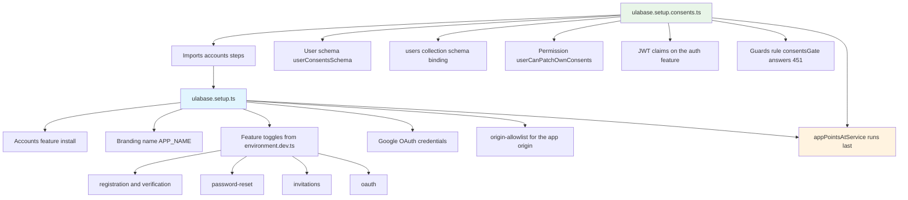
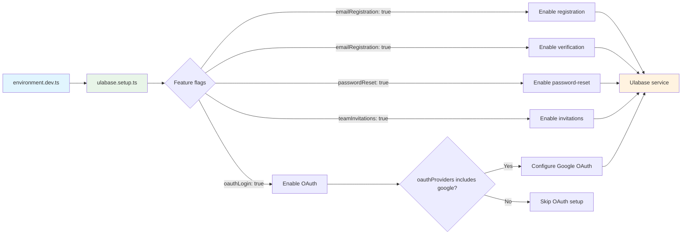
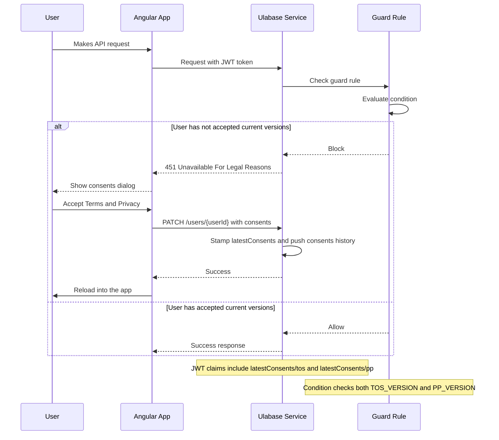
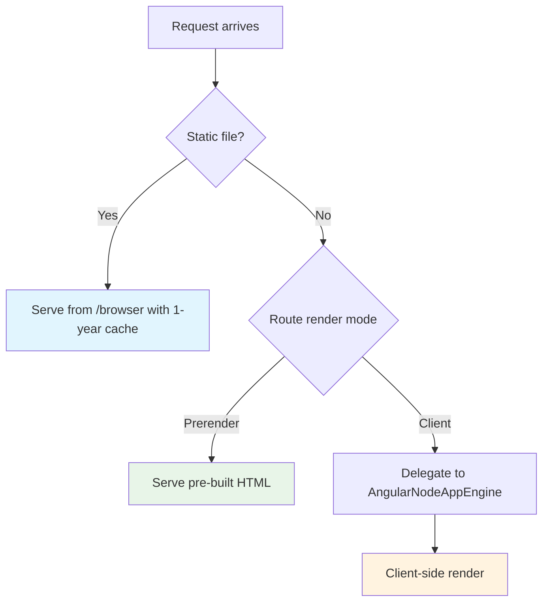
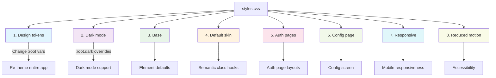

# Operations & Runbook

## Development

```bash
# Install dependencies
npm install

# Start dev server (uses environment.dev.ts)
ng serve
# → http://localhost:4200

# Build for production (uses environment.ts)
ng build

# Watch mode
ng build --watch --configuration development

# Run tests (Vitest via @angular/build:unit-test)
ng test

# Serve the SSR build (npm script)
npm run serve:ssr:ulabase-starter-ng
```

The `package.json` scripts wrap these Angular CLI commands (`start` → `ng serve`, `build` → `ng build`, `watch`, `test` → `ng test`) and add `serve:ssr:ulabase-starter-ng` for the SSR server. The 0.14.0 dependency bump pins `@ulabase/kit-ng` and `@ulabase/cli` at `^0.14.0`; unit tests run with `vitest` `^4.0.8` and `jsdom` `^28.0.0` as devDependencies (Vitest globals are enabled via `tsconfig.spec.json`).

## Environment configuration

Two environment files:

| File | Used by | Purpose |
|---|---|---|
| `src/environments/environment.dev.ts` | `ng serve` (development configuration file replacement) | Local development — point at a free Ulabase service |
| `src/environments/environment.ts` | `ng build` (production) | Production — point at a shared (or higher) service |

**Setup:**
1. Edit `environment.dev.ts` — set `apiUrl` to your service URL (e.g. `https://<id>.ulabase.app`). `ulabase setup` writes this line for you (see below).
2. Tell git to ignore local changes: `git update-index --assume-unchanged src/environments/environment.dev.ts`
3. Match `features` flags to your service's **Sign-up Mgmt → Features** toggles (or run `ulabase setup`, which derives those toggles from this same file)

**If `apiUrl` is empty or not a valid Ulabase service URL:** the app shows a "Connect your service" screen instead of the full app. This is intentional — see [`app.html`](../src/app/app.html).

## ulabase setup tooling

The repository ships two Ulabase setup files. They share one accounts definition; they differ in whether the consents gate is installed on the service:

| File | What it configures |
|---|---|
| `ulabase.setup.ts` | Accounts feature install; branding name (`APP_NAME`); accounts config (`frontend-url`, `frontend-app-url`, and the `features` toggles derived from `environment.dev.ts`); Google OAuth credentials when the app offers Google; the `origin-allowlist` for the app origin; and finally `appPointsAtService` |
| `ulabase.setup.consents.ts` | Imports every accounts step from `ulabase.setup.ts`, then appends the consents gate: the user schema, the `users` collection binding, a permission to PATCH one's own consents, JWT claims on the `auth` feature, and a guards rule that answers `451` until the current ToS and Privacy Policy are accepted; `appPointsAtService` still runs last |

The consents file reuses the accounts steps rather than restating them, so a fix in `ulabase.setup.ts` reaches both setups.



What each setup file installs on the service, in order.

### Check/apply pattern

Each setup step follows a **check/apply** pattern:
- **Check**: Verifies if the service already has the required configuration
- **Apply**: Makes the necessary changes only if the check fails

This ensures idempotent runs — re-running against an already-configured service writes nothing.

Two operational details the tooling handles for you:

- **409 already installed is success.** Feature installs go through a helper that swallows `409 Plugin already installed` and rethrows anything else. A forced apply against a service where the check would have said yes must not report a problem that does not exist.
- **Redacted secrets are preserved.** Feature-config updates are read-modify-write: the stored configuration is read first, and the server's redaction placeholders (bullets) are passed straight back. The server replaces the whole document and restores any field still holding a placeholder. Stripping "empty-looking" fields would write bullets over a real secret.

### Usage

```bash
# Install the CLI
npm i -D @ulabase/cli

# Login to your Ulabase account
ulabase login

# Preview what is missing (dry run)
ulabase setup --srv <srvId> --dry-run

# Apply the configuration
ulabase setup --srv <srvId>

# For consents gate setup
ulabase setup --srv <srvId> --file ulabase.setup.consents.ts
```

`--dry-run` runs the checks only and reports each step as satisfied or outstanding — the honest answer to "what is this service missing".

### Accounts setup (ulabase.setup.ts)

Steps run in this order:

1. **Accounts feature installed** — installs the `accounts` plugin if it is missing.
2. **Branding carries the app name** — writes `APP_NAME` (from `process.env.APP_NAME`, default `Ulabase Starter`) into the always-on `branding` feature config. The whole configuration is replaced, so it is read first and the console-set color and logo are preserved.
3. **Accounts configured to match the app** — sets `frontend-url` and `frontend-app-url` to `APP_URL` (from `process.env.APP_URL`, default `http://localhost:4200`) and merges the derived `features` toggles into the accounts feature config. `frontend-url` is where verification, reset and invitation email links point; `frontend-app-url` is where a verified or signed-in user lands.
4. **Google OAuth credentials** — only when `environment.dev.ts` has `oauthLogin` on and `oauthProviders` includes `'google'`. Enables the Google provider and fills `client-id` / `client-secret` from `GOOGLE_CLIENT_ID` / `GOOGLE_CLIENT_SECRET` **only when they are not already stored**, so a re-run against a configured service needs no secrets in the environment.
5. **The app origin may call the service** — installs the `origin-allowlist` feature if needed and adds `APP_URL` to `allowed-origins`. Origins are added, never replaced: a service reached from both localhost and a deployed app keeps both.
6. **`appPointsAtService`** — last, on purpose. It writes the service URL into the `apiUrl` line of `src/environments/environment.dev.ts` (comments and feature flags untouched) only once everything above it is in place. A setup that stops halfway leaves the "connect your service" screen, not a sign-up page that fails.

### Feature flag derivation

The setup tooling **imports the same environment the app uses** (`environment.dev.ts`) and derives the server's configuration from it. This eliminates the problem of two lists that must agree but are kept in step by hand:

- `emailRegistration` → enables both `registration` and `verification` on the server
- `passwordReset` → enables `password-reset` on the server
- `teamInvitations` → enables `invitations` on the server
- `oauthLogin` → enables `oauth` on the server (the Google credentials step runs only if `oauthProviders` includes `'google'`)

**Key benefit:** Turning a feature off in the app and re-running the setup turns it off on the service too, because there is no second place to forget.



Feature toggles in `environment.dev.ts` map to the service's accounts feature flags.

### Consents gate (ulabase.setup.consents.ts)

The consents setup runs every accounts step first (the gate blocks users the service cannot yet create has nothing to block), then installs four server-side documents plus the `guards` plugin:

1. **User schema** (`userConsentsSchema`) — defines `latestConsents` (`tos`, `pp`, `acceptedAt` as a BSON date via the escaped `_$date` type key) and the `consents` history array. Only `_id` and `roles` are required: demanding `latestConsents`, `consents`, password, profile, or team fields would reject every registration and every invitation. The schema is stored at `/schemas/userConsentsSchema` and then bound to the `users` collection via `/users/_meta`.
2. **Permission** (`userCanPatchOwnConsents`) — allows `user` to `PATCH /users/{userId}` when the path id is their own and the body whitelists only `consents`. The server-side `mergeRequest` stamps `latestConsents` with `TOS_VERSION`, `PP_VERSION`, and `acceptedAt: '@now'`, and `$push`es the same record onto the `consents` history. The client sends nothing about versions — it cannot accept terms it was never shown or backdate an acceptance.
3. **JWT claims** — `latestConsents/tos` and `latestConsents/pp` are added to `account-properties-claims` in the always-on `auth` feature configuration (added, not replaced). The guard reads the token, not the database: a missing claim would block every user for ever, including those who just accepted.
4. **Guards rule** (`consentsGate`) — after installing the `guards` feature, a rule blocks with status `451` when either current version is missing from the token claims. The condition requires an authenticated caller, exempts `/auth`, `/token`, and the acceptance PATCH itself, and deliberately does **not** exempt `/users/me` (reading the user document is what trips the gate client-side). `on_error: 'allow'` means a rule that cannot be evaluated must not lock everyone out.

**Version management:** The `TOS_VERSION` and `PP_VERSION` constants in the file control which versions are required. Bump these when publishing new documents and re-run the setup. Every user meets the acceptance form again on their next request; prior acceptances stay in the `consents` history. The check compares the rule's full condition, not merely its presence, so a version bump shows up as work outstanding.



The client-side of the gate is [`src/app/consents.ts`](../src/app/consents.ts) (raises `consentsBlocked` on any `451`) and [`src/app/consents-gate.ts`](../src/app/consents-gate.ts) (the root overlay). The overlay is user experience, not enforcement — the rule lives on the service.

## SSR deployment

The production build outputs:
- `dist/ulabase-starter-ng/browser/` — client assets
- `dist/ulabase-starter-ng/server/` — SSR server bundle

**Run the SSR server:**

```bash
# Build first
ng build

# Start the Express server
npm run serve:ssr:ulabase-starter-ng
# equivalent to: node dist/ulabase-starter-ng/server/server.mjs
# → http://localhost:4000 (or PORT env var)
```

The SSR server ([`src/server.ts`](../src/server.ts)):
1. Serves static files from `/browser` with 1-year cache
2. Delegates all other requests to `AngularNodeAppEngine`
3. Listens on `PORT` env var or defaults to 4000

**Render modes** (from [`app.routes.server.ts`](../src/app/app.routes.server.ts)):
- Auth pages (login, signup, forgot/reset password): **Prerender** — static HTML
- Verify, invitations, all authenticated routes: **Client** — rendered in browser only



The SSR server routes requests based on render mode configuration in `app.routes.server.ts`.

## CSS theming

`src/styles.css` is structured in 8 sections:

1. **Design tokens** — CSS custom properties in `:root`. Change these to re-theme.
2. **Dark mode** — overrides section 1 tokens under `:root.dark`.
3. **Base** — element-level defaults (`box-sizing`, body, typography, form controls, focus rings).
4. **Default skin** — semantic class hooks for components (`.card`, `.btn-*`, `.form-field`, `.form-error`, `.success-msg`, `.muted`, `.badge`, etc.).
5. **Auth pages** — login, signup, forgot/reset password, verify, accept-invite layout.
6. **Config page** — `.config-page` and `.config-card` shown when `environment.apiUrl` is not set.
7. **Responsive** — media queries for small screens.
8. **Reduced motion** — `prefers-reduced-motion` media query.



**Two restyling paths:**

### A. Tweak the skin (fastest — ~1 hour)
1. Change tokens in section 1
2. Adjust skin classes in sections 3–5 if you want different shapes
3. Page-specific CSS stays in `src/app/pages/**/*.css`

### B. Adopt a UI framework (Material, Spartan, Tailwind)
1. Delete sections 3–6 of `styles.css`
2. Reskin templates using the [semantic class hooks](../README.md#making-it-yours)
3. See [`TEMPLATE_API.md`](../TEMPLATE_API.md) for what each template binds to

**Key principle:** the default skin is a disposable mockup — a "deliberate, high-craft placeholder." Templates use a small, stable vocabulary of semantic class hooks (`.card`, `.btn-primary`, `.form-field`, `.form-error`, `.success-msg`, `.muted`, `.badge`). A reskin is a mechanical find-and-replace.

The one shared feedback component — [`Alert`](../src/app/ui/alert/alert.ts) — carries no styles of its own, only the `.success-msg`/`.form-error` hooks plus ARIA roles. Swap that one component and every success/error message follows.

## Porting to other frameworks

[`PORTING.md`](../PORTING.md) is the authoritative guide. Key points:

| Layer | Portable? | What to do |
|---|---|---|
| `@ulabase/kit` | 100% | Depend on it directly. Do not reimplement auth logic. |
| `styles.css` tokens + skin | 100% | Copy verbatim for visual parity. |
| Templates (HTML) | Structure yes, syntax no | Port markup, keep semantic class hooks. |
| Page CSS | Content yes, scoping no | Copy rules, swap scoping mechanism. |
| `kit-ng` (Angular adapter) | No | Rebuild equivalent for your framework. |
| Routing, guards, SSR | No | Reproduce the contract from PORTING.md. |

**Two behaviours easy to miss when porting:**
1. `checkSession()` also loads teams — screens rely on this
2. `login()` also loads teams in the same round trip

## Build budgets

From [`angular.json`](../angular.json):
- Initial bundle: 500kB warning, 1MB error
- Component styles: 4kB warning, 8kB error

## Code style

- **TypeScript:** strict mode, single quotes, 2-space indent (`.editorconfig`)
- **Prettier:** configured via `.prettierrc`
- **Angular:** zoneless change detection (no `zone.js`), signal-based state, reactive forms
- **Naming:** kebab-case for files, PascalCase for components, camelCase for signals/methods

## Common issues

### "Connect your service" screen appears
`apiUrl` is empty or not a valid Ulabase service URL. Edit the environment file and restart, or run `ulabase setup --srv <srvId>` so `appPointsAtService` writes the URL.

### 403 errors on auth endpoints
Feature flags in `environment*.ts` don't match your service's **Sign-up Mgmt → Features** toggles. A feature that's enabled in the frontend but disabled server-side returns 403. Re-run `ulabase setup --srv <srvId>` to derive the server toggles from the environment file.

### Consents dialog will not go away
The guards rule compares the token's `latestConsents/tos` and `latestConsents/pp` claims against `TOS_VERSION` / `PP_VERSION`. If you bumped those constants, re-run `ulabase setup --srv <srvId> --file ulabase.setup.consents.ts` so the rule and the permission's `mergeRequest` move together — accepting against one version pair while the rule demands another blocks the user for good.

### Team-dependent UI is empty
`checkSession()` or `login()` didn't load teams. Both must load teams as a side effect — see [Architecture](architecture.md#auth-state-model).

### Token expired mid-session
The token has a 15-minute TTL with silent refresh at ~80%. If refresh fails (network issue), the next API call returns 401 and the interceptor clears the session.

### SSR build breaks with ThemeService
ThemeService touches `localStorage` and `document` — safe only in client-rendered contexts. If injected into a prerendered page, it will break the SSR build. The `isPlatformBrowser` guard is already in place.

### Demo fetch feature not working
The home page's "Fetch your data" demo requires:
1. A Ulabase service with a `/demo` collection
2. A permission allowing the signed-in user to read it: `path(/demo) and method(GET)`
3. The user must be authenticated (the demo uses `auth.api()` which requires a valid session)

If the demo button shows an error, check:
- Network tab for the `/demo` request — verify it's being sent with the bearer token
- Ulabase dashboard — verify the `/demo` collection exists and has the correct permission
- Console for any CORS or authentication errors

## Change navigation for operations

### For environment configuration changes
- **Start with:** `src/environments/environment.ts` and `src/environments/environment.dev.ts`
- **Check:** `src/app/app.routes.ts` for feature flag usage
- **Test with:** `ng serve` and verify "Connect your service" screen appears for invalid URLs
- **Validation:** Feature flags match your Ulabase service's **Sign-up Mgmt → Features** toggles (or re-run `ulabase setup`)

### For ulabase setup / service provisioning changes
- **Start with:** `ulabase.setup.ts` (accounts, branding, OAuth, origin-allowlist) and `ulabase.setup.consents.ts` (schema, permission, JWT claims, guard)
- **Check:** `src/environments/environment.dev.ts` — the setup imports it for feature derivation
- **Test with:** `ulabase setup --srv <srvId> --dry-run`, then apply (add `--file ulabase.setup.consents.ts` for the gate)
- **Validation:** Dry run reports every step satisfied; a second apply writes nothing

### For SSR deployment changes
- **Start with:** `src/server.ts` for Express server configuration
- **Check:** `src/app/app.routes.server.ts` for render mode assignments
- **Test with:** `ng build && npm run serve:ssr:ulabase-starter-ng`
- **Validation:** Server starts on PORT or defaults to 4000, auth pages are prerendered

### For CSS theming changes
- **Start with:** `src/styles.css` for design tokens and default skin
- **Check:** `src/app/pages/**/*.css` for page-specific styles
- **Test with:** `ng serve` and toggle theme (dark/light)
- **Validation:** Design tokens are applied correctly, dark mode works

### For build and deployment changes
- **Start with:** `package.json` for scripts, `angular.json` for build configuration
- **Check:** Build budgets (500kB warning, 1MB error for initial bundle)
- **Test with:** `ng build` and verify no budget warnings
- **Validation:** Build succeeds, SSR server starts without errors
