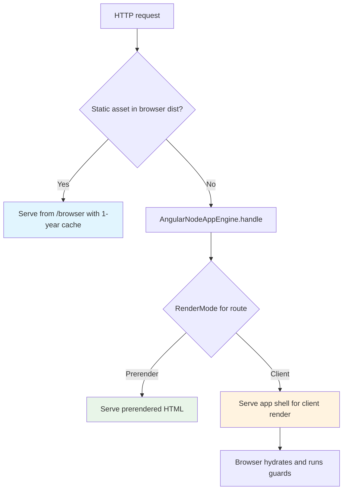

# Operations Runbook

Build, serve, and SSR deployment commands; environment configuration; and troubleshooting for the failures this starter actually hits. Theming and porting live in [Theming and Porting](theming-and-porting.md); service provisioning details live in [Service Setup](../workflows/service-setup.md). Runtime and render-mode architecture is in [Application Runtime and SSR](../architecture/app-runtime.md).

## Build and serve

```bash
npm install                 # Node.js 22.18 or later (the setup file is TypeScript)

npm start                   # ng serve — dev server, environment.dev.ts
ng serve                    # same, default http://localhost:4200

ng build                    # production build, environment.ts
npm run build               # same

npm run watch               # ng build --watch --configuration development

npm test                    # ng test — Vitest via @angular/build:unit-test

npm run serve:ssr:ulabase-starter-ng
# equivalent to: node dist/ulabase-starter-ng/server/server.mjs
```

The `package.json` scripts wrap the Angular CLI: `start` → `ng serve`, `build` → `ng build`, `watch` → `ng build --watch --configuration development`, `test` → `ng test`, plus `serve:ssr:ulabase-starter-ng` for the SSR server.

Declared versions (from `package.json`): `@ulabase/kit-ng` and `@ulabase/cli` at `^0.15.0`; unit tests run with `vitest` `^4.0.8` and `jsdom` `^28.0.0` as devDependencies (Vitest globals are enabled via `tsconfig.spec.json`). Angular packages are at `^21.2.0` with `@angular/ssr` at `^21.2.7`; the SSR server is Express 5.

Build budgets in `angular.json`: initial bundle 500kB warning / 1MB error; component styles 4kB warning / 8kB error. `test` uses the `@angular/build:unit-test` builder.

## Environment configuration

Two environment files, selected by the build configuration:

| File | Used by | Purpose |
|---|---|---|
| `src/environments/environment.dev.ts` | `ng serve` (development configuration file replacement) | Local development — point at a free Ulabase service |
| `src/environments/environment.ts` | `ng build` (production) | Production — point at a shared (or higher) service |

`angular.json` swaps `environment.ts` for `environment.dev.ts` in the development build configuration; `serve` defaults to `development` and `build` defaults to `production`.

Both files carry the same shape: an `apiUrl` string and a `features` object (`emailRegistration`, `passwordReset`, `oauthLogin`, `oauthProviders`, `teamInvitations`).

**Environment story:**

1. `ng serve` reads `environment.dev.ts`. Production builds read `environment.ts`.
2. `ulabase setup` writes the service URL into the `apiUrl` line of `environment.dev.ts` (`appPointsAtService`, last of the setup steps). Set `environment.ts` yourself when you build for production.
3. Tell git to ignore local `apiUrl` edits: `git update-index --assume-unchanged src/environments/environment.dev.ts`.
4. An empty or invalid `apiUrl` shows the **connect-your-service** screen instead of the app. This is intentional — `app.config.ts` registers an empty route table so route guards never call `checkSession()` against a missing backend.

Feature flags must match the service's **Sign-up Mgmt → Features** toggles. `ulabase setup` derives those toggles from `environment.dev.ts`, so re-running setup is usually the fix when they drift. A feature that is off on the server returns `403` to unauthenticated users — set the matching client flag to `false` so the app does not offer UI for it.

## Service setup

```bash
npm install -g ulabase
ulabase login                              # paste a token from ulabase.com
ulabase setup --srv <srvId>                # accounts, branding, features, origin, apiUrl
ulabase setup --srv <srvId> --dry-run      # what is missing, without writing
ulabase setup --srv <srvId> --file ulabase.setup.consents.ts   # adds the consents gate
```

Every step is a check and an apply; a second run writes nothing. The step order in `ulabase.setup.ts`: accounts feature install, branding name (`APP_NAME`, default `Ulabase Starter`), accounts config (`frontend-url` / `frontend-app-url` and feature toggles derived from `environment.dev.ts`), Google OAuth credentials when the app offers Google, origin-allowlist (adds `APP_URL`, never replaces), and finally `appPointsAtService` (writes `apiUrl` only once everything above is in place).

`APP_URL` comes from `process.env.APP_URL`, default `http://localhost:4200`. When you change where the app is served from, re-run setup so the origin allowlist and email links follow.

The consents variant (`ulabase.setup.consents.ts`) imports the accounts steps and appends the server-side gate documents. See [Consents Gate](../concepts/consents-gate.md) for the rule semantics and [Service Setup](../workflows/service-setup.md) for the provisioning walkthrough.

## SSR deployment

Production build output:

- `dist/ulabase-starter-ng/browser/` — client assets
- `dist/ulabase-starter-ng/server/` — SSR server bundle

```bash
ng build
npm run serve:ssr:ulabase-starter-ng
# or: node dist/ulabase-starter-ng/server/server.mjs
# → http://localhost:4000 (or $PORT)
```

The SSR server (`src/server.ts`) serves static files from `../browser` with a 1-year cache (`index: false`, `redirect: false`), then delegates every other request to `AngularNodeAppEngine`. It listens on `PORT` or defaults to **4000**, and starts when the module is the main entry or under PM2 (`process.env['pm_id']`).



SSR request path: static assets first, then AngularNodeAppEngine by the route's render mode.

### Render-mode expectations

Declared in `src/app/app.routes.server.ts`, which must mirror the client routes in `app.routes.ts` (a mismatch fails the SSR build). Feature-flag conditionals on server routes mirror the same flags on the client routes.

| Path | RenderMode | Gated by |
|---|---|---|
| `auth/login` | `Prerender` | always |
| `auth/signup` | `Prerender` | `emailRegistration \|\| oauthLogin` |
| `auth/verify` | `Client` | `emailRegistration` |
| `auth/forgot-password`, `auth/reset-password` | `Prerender` | `passwordReset` |
| `auth/activate`, `invitations/accept` | `Client` | `teamInvitations` |
| `''` (authenticated shell) | `Client` | always |
| `**` | `Client` | always |

Public auth pages prerender where possible. Verify and invitation pages are `Client` because they call the API on init. The authenticated shell and catch-all are `Client` because the bearer token lives in browser `localStorage`, not in a cookie the server receives. When adding a route, add it to both `app.routes.ts` and `app.routes.server.ts`.

## Troubleshooting

### Everything fails — "origin is not allowed"

The service only answers origins it has been told about. Re-run `ulabase setup` after changing where the app is served from, or add the origin under *Service → Origin Allowlist*. The setup step adds `APP_URL` to `allowed-origins` and never replaces the list, so a service reached from both localhost and a deployed app keeps both.

### A page is missing and its link is gone — `403` on auth endpoints

Feature flags in `environment*.ts` must match the service's **Sign-up Mgmt → Features** toggles. A feature enabled in the frontend but disabled server-side returns `403`. `ulabase setup` reads the flags from `environment.dev.ts` and sets the service to match — re-running it is usually the fix.

### `401` on a request you wrote yourself

A plain `fetch` carries no session. Use `auth.api()`, which attaches the bearer token. Requests through `HttpClient` to `apiUrl` are already covered by `rhAuthInterceptor`; requests to any other host pass through untouched. On `401` or token expiry the interceptor clears the session. The token has a 15-minute TTL with silent refresh at ~80%.

### Consents dialog will not go away — `451` after a version bump

The guards rule compares the token's `latestConsents/tos` and `latestConsents/pp` claims against `TOS_VERSION` / `PP_VERSION` in `ulabase.setup.consents.ts` (currently both `2026-07-01`). If you bumped those constants, re-run `ulabase setup --srv <srvId> --file ulabase.setup.consents.ts` so the rule and the permission's `mergeRequest` move together. Accepting against one version pair while the rule demands another blocks the user until the setup is re-applied. Keep the `Version 2026-07-01` line in `public/terms.html` and `public/privacy.html` in step as well. See [Consents Gate](../concepts/consents-gate.md).

### Team-dependent UI is empty

`checkSession()` and `login()` must load teams as a side effect. `checkSession()` short-circuits to `null` with empty teams when no token is stored (no HTTP call); otherwise it fetches the user and then the teams. `login()` loads teams in the same round trip. Screens such as the home page read the active team without calling `loadTeams()` themselves because `authGuard` already ran `checkSession()`. If a port or refactor skips these side effects, team UI is intermittently empty.

### Theme toggle breaks the SSR build

`ThemeService` touches `localStorage` and `document`. It is guarded by `isPlatformBrowser` and today is only injected from the client-rendered shell. Injecting it into a prerendered page without that guard breaks the SSR build.

### Demo fetch fails — `/demo` collection permissions

The home page's "Fetch your data" demo calls `auth.api('/demo')`. It needs:

1. A `/demo` collection on the Ulabase service.
2. A permission allowing the signed-in user to read it: `path(/demo) and method(GET)`.
3. An authenticated session (the demo uses `auth.api()`, which requires one).

If the button errors, check the network tab for the `/demo` request and its bearer token, and the Ulabase dashboard for the collection and permission.

### `ulabase` runs something about OpenShift

A different, retired tool of the same name is first in your `PATH`. `type -a ulabase` shows both.

## Related pages

- [Application Runtime and SSR](../architecture/app-runtime.md) — bootstrap, hydration, render modes, Express server
- [Consents Gate](../concepts/consents-gate.md) — 451 overlay, version bump semantics
- [Theming and Porting](theming-and-porting.md) — design tokens, skin swap, porting parity
- [Service Setup](../workflows/service-setup.md) — `ulabase setup` provisioning steps
- [Testing Guidance](../testing/guidance.md) — manual flows and validation
