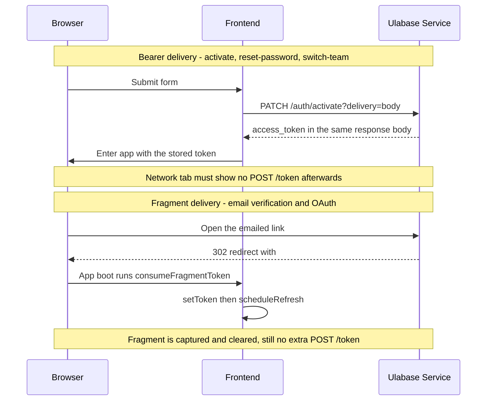

# Testing Guidance

This page is the test reality for ulabase-starter-ng: what the automated suite actually proves, the manual checklist that carries everything else, what to verify per change area, and the browser DevTools checks that catch bearer-token regressions. Source code and tests are authoritative — a spec's name is not coverage. When the two disagree, trust the source.

## Automated unit tests

### How they run

`npm test` is an alias for `ng test`, which runs Vitest through the `@angular/build:unit-test` builder. `jsdom` and `vitest` are devDependencies; `tsconfig.spec.json` enables `vitest/globals` (matchers and lifecycle hooks without explicit imports) and includes `src/**/*.spec.ts`. There is no separate Vitest config file — the Angular CLI builder owns discovery and execution.

```bash
npm test          # ng test — Vitest via @angular/build:unit-test
```

### What the specs assert

All ten spec files assert **component creation only**: they compile a component in `TestBed`, create the fixture, and run `expect(...).toBeTruthy()`. There is no automated E2E suite (no Cypress, Playwright, or equivalent) — every behavioral flow is hand-verified.

| Spec | Component | Notes |
| --- | --- | --- |
| `src/app/app.spec.ts` | `App` | Asserts the app root constructs |
| `src/app/pages/auth/login/login.spec.ts` | `Login` | Creation only |
| `src/app/pages/auth/signup/signup.spec.ts` | `Signup` | Creation only |
| `src/app/pages/auth/verify/verify.spec.ts` | `Verify` | Creation only |
| `src/app/pages/auth/forgot-password/forgot-password.spec.ts` | `ForgotPassword` | Creation only |
| `src/app/pages/auth/reset-password/reset-password.spec.ts` | `ResetPassword` | Creation only |
| `src/app/pages/auth/oauth-buttons/oauth-buttons.spec.ts` | `OauthButtons` | Creation only; sets the `providers` input via `setInput()` |
| `src/app/pages/invitations/accept/accept.spec.ts` | `Accept` | Creation only |
| `src/app/pages/account/account.spec.ts` | `Account` | Creation only |
| `src/app/pages/shell/shell.spec.ts` | `Shell` | Creation only |

Most specs follow one pattern: `TestBed.configureTestingModule` with `provideRouter([])` and a mock `RH_AUTH_CONFIG` (`{ apiBaseUrl: 'http://localhost:8080' }`), then create the fixture and assert truthiness. The `OauthButtons` spec is the exception — it omits both the router and `RH_AUTH_CONFIG` and instead sets its required `providers` input via `fixture.componentRef.setInput('providers', ['google', 'github'])`.

There are **no** spec files for `Teams`, `TeamDetail`, `NewTeam`, `Home`, or `ConsentsGate`. No spec exercises form submission, navigation, guard redirects, HTTP calls, or error-message copy.

## Manual TEST-CASES.md checklist

[`TEST-CASES.md`](../../TEST-CASES.md) is the hand-run checklist. It is the only automated-adjacent safety net for auth and team behavior: run it after bumping `@ulabase/kit` / `@ulabase/kit-ng`, or after touching anything under `src/app/pages/auth/` or `src/app/pages/invitations/`.

Sections in the checklist:

1. **Signup & email verification** — confirmation message, verification email, automatic login from the link, `#access_token` fragment, duplicate-email and weak-password rejection.
2. **Login / logout** — correct and wrong credentials, session persistence across reload, idle renewal via `GET /token?renew`.
3. **Forgot / reset password** — same confirmation for existing and non-existing emails; reset logs the user in; old password stops working.
4. **Team invitations — new user** (`/auth/activate`) — set-password form with org name/role, activation logs straight in, invalid/expired invite error.
5. **Team invitations — existing user** (`/invitations/accept`) — login-first accept while signed out, direct accept while signed in, new team in the switcher.
6. **Team switcher** — visibility only with more than one team, immediate active-team update, `POST /auth/switch-team?delivery=body`.
7. **OAuth (Google / GitHub)** — provider consent, auto account + team creation, invitation acceptance from both invite paths.
8. **Session / guards** — logged-out redirect to `/auth/login`, logged-in redirect away from it, expired/invalid token clears the session, hard refresh mid-session.

Use the browser Network tab wherever the checklist says so.

## What to test per change area

The matrix follows the current route table (including the dual-path invitation page) and the feature-flag gates in [`src/app/app.routes.ts`](../../src/app/app.routes.ts).

| Change area | Source entry points | Automated | Manual focus | Minimal validation |
| --- | --- | --- | --- | --- |
| **Auth pages** (signup, login, verify, forgot/reset password, OAuth buttons) | `src/app/pages/auth/*` | Creation specs only (`login`, `signup`, `verify`, `forgot-password`, `reset-password`, `oauth-buttons`) | TEST-CASES.md sections 1–3 and 7; error copy; welcome banner only on fresh signup | `npm test`, then the matching checklist sections |
| **Invitation page** (dual path `/auth/activate` and `/invitations/accept`, one unguarded `Accept` component) | `src/app/pages/invitations/accept/`, route map in `app.routes.ts` | `accept.spec.ts` (creation only) | TEST-CASES.md sections 4–5 — both paths, signed-out and signed-in, invalid/expired invite | `npm test`, then both invitation sections |
| **Team management** (list, new, detail, switcher, members) | `src/app/pages/teams/*` | None | TEST-CASES.md sections 5–6; team switcher visibility and active-team update | Checklist sections 5–6 |
| **Account** | `src/app/pages/account/account.ts` | `account.spec.ts` (creation only) | Profile update and password change by hand | `npm test`, then manual |
| **Routing & guards** (`authGuard`, `publicGuard`, titles) | `src/app/app.routes.ts` | None beyond `app.spec.ts` construction | TEST-CASES.md section 8; redirect directions in both signed-in states | Manual navigation; keep `app.routes.server.ts` in sync |
| **Feature-flag gating** | `src/environments/environment*.ts`, conditional spreads in `app.routes.ts` | None | Flip a flag, confirm the route and its UI links disappear together | `ng serve` with the flag off |
| **Session / token lifecycle** | `src/app/app.ts` (`consumeFragmentToken`), `@ulabase/kit-ng` | None | TEST-CASES.md sections 2 and 8; idle renewal; fragment capture | Network tab during login and verification |
| **SSR render modes** | `src/app/app.routes.server.ts`, `src/server.ts` | None | Public routes prerender (view source shows HTML); client-only routes do not | `ng build && node dist/ulabase-starter-ng/server/server.mjs` |
| **Consents gate** (451 overlay) | `src/app/consents.ts`, `src/app/consents-gate.ts` | None | Overlay appears on 451, acceptance works, sign-out clears state | Simulate a 451, then the acceptance path |

When adding or renaming a route, mirror it in **both** `app.routes.ts` and `app.routes.server.ts` — a mismatch fails SSR route extraction at build time, not a unit test.

## DevTools checks

Three checks catch the regressions unit tests cannot see. Run them whenever auth, invitation, or token handling changes.

1. **`Authorization: Bearer` on `auth.api()` calls** — custom authenticated calls (for example the home page's `/demo` fetch in `src/app/pages/home/home.ts`) must carry an `Authorization: Bearer …` request header. A missing header means token attachment is broken.
2. **`#access_token` fragment capture** — after email verification (and OAuth), the backend 302-redirects to the app with `#access_token=…&token_type=Bearer&expires_in=…` in the URL fragment. `consumeFragmentToken()` in `src/app/app.ts` must pick it up (`setToken()` + `scheduleRefresh()`) and strip the fragment (and the one-shot `?flow=signup` marker) from the URL bar before routing settles.
3. **No extra `POST /token` after bearer-delivery flows** — bearer mode must never make a follow-up `POST /token` after `activate`, `reset-password`, or `switch-team`. Each of those is called with `?delivery=body` and returns `access_token` in the same response.



*Expected Network-tab pattern for the two bearer-token delivery paths covered by TEST-CASES.md.*

Related manual checks from the checklist: the verify redirect carries `#access_token=…` in the fragment (not a second token exchange); `PATCH /auth/reset-password?delivery=body` and `PATCH /auth/activate?delivery=body` each return `access_token` directly; `POST /auth/switch-team?delivery=body` returns the new token and the session reflects the new team without a page reload; idle past ~12 minutes (80% of the 15-minute TTL) renews via `GET /token?renew`.

## Behavior not covered by specs

Because every spec only asserts construction, the following are **unasserted** — verify them manually:

- **`token_expired` error copy** — when a verification link fails with `token_expired`, `Login` shows a message that points at **"Forgot password?"** and states that it also verifies the email (`ERROR_MESSAGES` in `src/app/pages/auth/login/login.ts`). The verify page shows the same guidance (`src/app/pages/auth/verify/verify.html`). Neither `login.spec.ts` nor `verify.spec.ts` asserts this copy or the router link behind it.
- **Guard redirects** — `authGuard` sending logged-out users to `/auth/login`, and `publicGuard` sending signed-in users into the shell.
- **Form validation and API error mapping** — duplicate-email (409) and wrong-credentials (401) messages, weak-password rejection, missing invite params.
- **Feature-flag route removal** — a disabled flag must remove both the route and the UI that links to it.
- **Dual-path invitation behavior** — new-user set-password vs existing-user login-then-accept, and the 404-with-session redirect back into the app.
- **Consents gate overlay** — 451 handling, acceptance, and sign-out clearing `consentsBlocked`.
- **Silent renewal and session clearing** — `GET /token?renew` at ~80% TTL, and session teardown on 401/expiry.

## SSR verification

Public auth routes (`auth/login`, `auth/signup`, `auth/forgot-password`, `auth/reset-password`) are prerendered; `auth/verify`, both invitation paths, and the authenticated shell are `RenderMode.Client` (they need live API calls or a browser-stored token). Verify the split with a production build and the SSR server:

```bash
ng build && node dist/ulabase-starter-ng/server/server.mjs
```

View source on a public auth page and confirm HTML is present; confirm the authenticated shell is client-rendered only. A hard refresh mid-session should preserve the login once CSR takes over.

## Related pages

- [Routing, Guards, and Feature Flags](../architecture/routing-and-guards.md) — route table, guards, and the `app.routes.ts` / `app.routes.server.ts` sync rule
- [Auth and Session Architecture](../architecture/auth-session.md) — token lifecycle, fragment capture, and the session invariants checked by hand
- [Auth Flows](../workflows/auth-flows.md) — signup, verification, login, and password-reset flows these tests exercise
- [Teams and Invitations](../workflows/teams-and-invitations.md) — the dual-path invitation and team-switch flows these tests exercise
- [Operations Runbook](../operations/runbook.md) — build, `npm test`, and SSR server commands
- [Source Map](../source-map.md) — where each spec and checklist file lives
