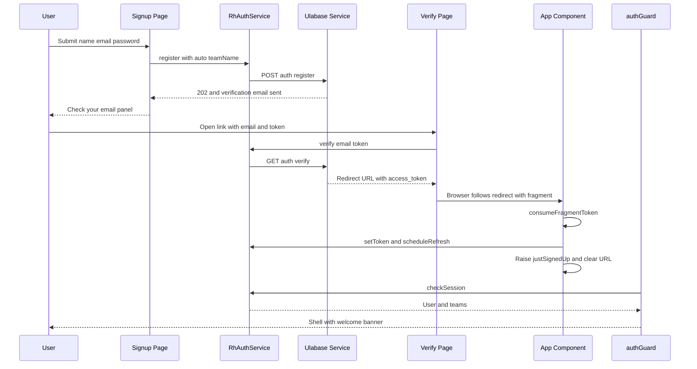

# Auth Workflows

This page walks the authentication journeys a user actually takes: creating an account and
proving the email, signing in and out, signing in with Google or GitHub, resetting a
password, and recovering when a verification link has gone stale. Route maps and guard
placement live in [Routing and Guards](../architecture/routing-and-guards.md); the
bearer-token and session mechanics those flows rely on are in
[Auth and Session Architecture](../architecture/auth-session.md). Manual checks for each
journey are in [Testing Guidance](../testing/guidance.md) and `TEST-CASES.md`.

Every auth screen is behind `publicGuard`, so a signed-in user who navigates to
`/auth/login` (or any other auth page) is redirected into the shell; the authenticated shell
itself is behind `authGuard`, which restores the session or sends the visitor to
`/auth/login`. The two guards plus the unguarded invitation pages are covered in
[Routing and Guards](../architecture/routing-and-guards.md).

## Signup and email verification

**Entry:** `/auth/signup`, gated by the `emailRegistration` or `oauthLogin` feature flags.

1. The form collects first name, last name, email, and a password of at least 8 characters.
2. The API requires a team name, but the form does not ask for one.
   [`Signup`](../../src/app/pages/auth/signup/signup.ts) generates
   `` `${firstName}'s Team` `` — or `` `${email.split('@')[0]}'s Team` `` when the first name
   is empty — and passes it to `auth.register({ teamName, firstName, lastName, email, password })`.
3. On success the form is replaced by a "Check your email" panel. The user is **not** logged
   in yet; the account still has to be verified.
4. A `409` is mapped to "An account with this email already exists."
5. The service emails a verification link that lands on
   `/auth/verify?email=...&token=...`.
6. [`Verify`](../../src/app/pages/auth/verify/verify.ts) reads `email` and `token` from the
   query string and calls `auth.verify(email, token)`, which **returns a redirect URL**. The
   component assigns that URL to `window.location.href` — there is no client-side form and
   no second token exchange.
7. The backend 302-redirects the browser back to the app with
   `#access_token=...&token_type=Bearer&expires_in=900` in the URL fragment. (When the link
   itself is dead, the backend redirects here with `?error=...` instead — see
   [Dead verification links](#dead-verification-links).)
8. On app start, [`consumeFragmentToken()`](../../src/app/app.ts) — browser only, before
   routing settles — stores the fragment token with `setToken()`, starts silent renewal with
   `scheduleRefresh({ apiBaseUrl })`, reads the one-shot `?flow=signup` marker into the
   [`justSignedUp`](../../src/app/just-signed-up.ts) signal, and strips both from the URL
   bar with `history.replaceState`.
9. `authGuard` then runs `checkSession()`, which loads the user and teams, and the shell
   renders with the welcome banner.

Signup through email verification into the authenticated shell.

### The `?flow=signup` welcome banner

`?flow=signup` is present only on the one redirect that follows a **fresh** signup — email
verification *or* OAuth. [`app.ts`](../../src/app/app.ts) raises the in-memory
[`justSignedUp`](../../src/app/just-signed-up.ts) signal and deletes the marker from the
URL; [`shell.ts`](../../src/app/pages/shell/shell.ts) copies the flag into a local signal
and immediately resets the shared one so the banner cannot reappear on a later login. The
flag is never persisted.

Because the same flag fires for OAuth signups, the banner copy must **not** claim an email
was verified. The template
([`shell.html`](../../src/app/pages/shell/shell.html)) says "Welcome aboard — your account
is ready." — accurate for both paths.

## Login, logout, and session persistence

**Entry:** `/auth/login` (always registered).

1. The user submits email and password; [`Login`](../../src/app/pages/auth/login/login.ts)
   calls `auth.login(email, password)`, which also loads teams in the same round trip, then
   navigates to `/`.
2. A `401` is mapped to "Invalid email or password."; any other failure shows the server
   message or a generic fallback.
3. The login page also surfaces **backend link failures** via `?error=...`. The backend
   redirects here when a link it handled directly fails (typically a dead verification
   link). `ERROR_MESSAGES` in `login.ts` is the source of the copy:
   - `invalid_token` → "This link is invalid or has expired."
   - `token_expired` → points at **Forgot password?** and states that it also verifies the
     email (see [Dead verification links](#dead-verification-links)).
4. Logout ([`shell.ts`](../../src/app/pages/shell/shell.ts)) calls `auth.logout()` and
   navigates to `/auth/login`, clearing the session.

**Session persistence.** After login the kit stores the bearer token. A hard refresh keeps
the session because `authGuard` runs `checkSession()`, which reads the stored token, fetches
the user, and loads the teams as a side effect (no HTTP call when no token is stored —
treated as a signed-out visit). Idle past ~12 minutes (about 80% of the 15-minute token TTL)
`scheduleRefresh()` silently renews via `GET /token?renew`; an expired or invalid token is
cleared on the next API call rather than hanging. See
[Auth and Session Architecture](../architecture/auth-session.md) for the interceptor and
refresh contract.

## OAuth sign-in

**Entry:** OAuth buttons on the login and signup pages, gated by the `oauthLogin` flag and
the `oauthProviders` list in `environment.features`.

1. [`OauthButtons`](../../src/app/pages/auth/oauth-buttons/oauth-buttons.ts) renders one
   plain `<a href>` per provider — not a fetch — to
   `{apiUrl}/auth/oauth/authorize/{provider}?noauthchallenge`
   ([`oauthUrl()`](../../src/app/oauth-url.ts)).
2. `noauthchallenge` tells the Ulabase service to skip its own credential challenge and go
   straight to the provider redirect. The browser follows the full consent flow on the
   provider's site; the backend exchanges the code and 302-redirects back to the app.
3. Return is the same fragment-token capture as email verification: `#access_token=...` is
   consumed by `consumeFragmentToken()` before any guard runs.
4. A first-time OAuth user gets an account **and** a team created automatically — there is
   no separate signup form.
5. When the redirect carries `?flow=signup`, the welcome banner appears exactly as it does
   after email verification, so the copy must stay provider-neutral.

## Password reset

**Entry:** `/auth/forgot-password`, gated by the `passwordReset` flag.

1. The user submits an email.
   [`ForgotPassword`](../../src/app/pages/auth/forgot-password/forgot-password.ts) calls
   `auth.forgotPassword(email)`.
2. **The API always answers `202`,** whether or not the address is registered, so the
   endpoint cannot be used to enumerate accounts. The client mirrors that: both the success
   and the error callback set `submitted`, and the same confirmation panel is shown either
   way ("If an account exists for that address, we sent a link..."). Do not add distinct
   error handling here — that would leak existence.
3. The same request also **resends the verification email** when the account is not yet
   verified, which is why the dead-link recovery path routes users here.
4. The reset link lands on `/auth/reset-password?email=...&token=...`.
   [`ResetPassword`](../../src/app/pages/auth/reset-password/reset-password.ts) requires a
   new password of at least 8 characters and calls
   `auth.resetPassword({ email, token, password })`.
5. That call is `PATCH /auth/reset-password?delivery=body`: the response body carries
   `access_token` directly. A correct client **never** issues a follow-up `POST /token`
   after this (the same bearer-delivery pattern as `activate` and `switch-team` — see
   [External Dependencies](../integrations/external-dependencies.md)).
6. On success the user is already signed in and is navigated to `/`. A `401` is mapped to
   "This reset link is invalid or has expired." Missing `email`/`token` query params render
   an "Invalid link" panel that offers a new request.

## Dead verification links

A stale or invalid verification link is recoverable, not a dead end. Two surfaces give the
same guidance:

- [`verify.html`](../../src/app/pages/auth/verify/verify.html), when the backend redirects
  to `/auth/verify?error=...`, says the link is invalid or expired and points at
  **Forgot password?** — "it also verifies your email."
- `login.ts` `ERROR_MESSAGES.token_expired` (surfaced when the backend redirects the link
  failure to `/auth/login?error=token_expired`) says the same thing;
  `invalid_token` shows the shorter "This link is invalid or has expired."

Both paths lead to [password reset](#password-reset). Completing that flow issues a fresh
link and verifies the account, because `POST /auth/forgot-password` resends the verification
email for an unverified account.

## Focused manual checks

The unit specs under `src/app/pages/auth/**` only assert component creation. The behaviours
above are verified by hand from `TEST-CASES.md` (typically after bumping `@ulabase/kit` /
`@ulabase/kit-ng` or touching anything under `pages/auth/`):

| Flow | What to confirm |
|---|---|
| Signup | Confirmation panel without a session; duplicate email shows "account already exists"; weak password rejected |
| Verification | Link lands in the app signed in; redirect fragment carries `#access_token=...` and no extra `/token` call; welcome banner appears and copy does not claim "email verified" |
| Login / logout | Wrong password → "Invalid email or password."; logout clears the session and returns to `/auth/login`; reload keeps the session; idle ~12 min renews via `GET /token?renew` |
| OAuth | Provider consent completes and signs in; new user gets account + team |
| Password reset | Same confirmation for known and unknown emails; `PATCH /auth/reset-password?delivery=body` returns `access_token` with no follow-up `POST /token`; old password stops working |
| Dead link | Expired/invalid verification link shows the Forgot-password recovery copy on both the verify page and the login page |

More on how to run these checks, including the Network-tab assertions for bearer delivery,
is in [Testing Guidance](../testing/guidance.md).
