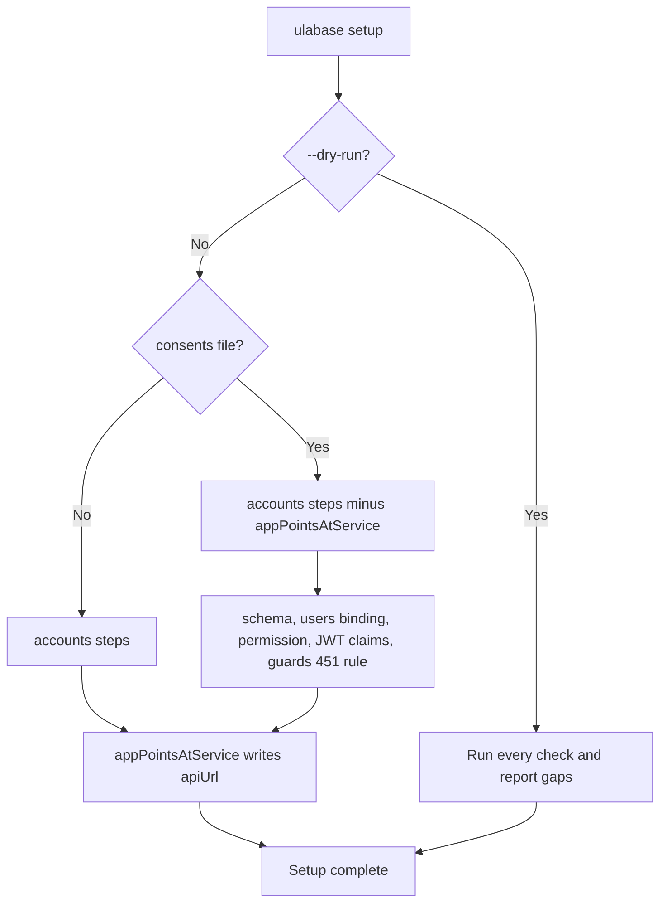

# Service Setup Workflow

Provisioning a Ulabase service for this starter is code, not a console checklist. The `ulabase` CLI reads one of two TypeScript setup files in the repository root, walks a list of `check`/`apply` steps against the service named by `--srv`, and reports what was already satisfied versus what it changed. The accounts-only variant is [`ulabase.setup.ts`](../../ulabase.setup.ts); the consents variant is [`ulabase.setup.consents.ts`](../../ulabase.setup.consents.ts), which reuses the accounts steps and appends the server-side gate documents.

This page covers the pipeline itself: entry commands, the check/apply contract, the accounts step order, feature-flag derivation from [`src/environments/environment.dev.ts`](../../src/environments/environment.dev.ts), secret and redaction handling, the consents variant's composition, and the `TOS_VERSION`/`PP_VERSION` bump procedure. Rule and overlay semantics live in [Consents Gate](../concepts/consents-gate.md); day-to-day troubleshooting lives in [Operations Runbook](../operations/runbook.md); the CLI package boundary is in [External Dependencies](../integrations/external-dependencies.md).

## Entrypoints

```bash
npm install -g ulabase          # or: npm i -D @ulabase/cli
ulabase login                   # paste a token from ulabase.com
ulabase setup --srv <srvId> --dry-run    # what is missing, without writing
ulabase setup --srv <srvId>              # make it so
ulabase setup --srv <srvId> --file ulabase.setup.consents.ts   # accounts plus the consents gate
```

`<srvId>` is the six-character id of the service — the first label of its URL. `--file` selects the setup definition; without it the CLI runs the default `ulabase.setup.ts`. `--dry-run` runs every step's `check` and never its `apply`. With no `--file`, the starter is configured for accounts only: the client-side consents code is still present, but no server rule exists, so no request is ever answered `451`.

Two environment variables shape the accounts setup at run time:

| Variable | Default | Used for |
|---|---|---|
| `APP_URL` | `http://localhost:4200` | email `frontend-url` / `frontend-app-url`, origin allowlist entry |
| `APP_NAME` | `Ulabase Starter` | branding `name` on the sign-in page and in service emails |

## The check/apply model

Each setup file exports a `defineSetup(...)` call whose second argument is an ordered array of `step(...)` objects from `@ulabase/cli`. A step has a `check` (is the service already in the desired state?) and an `apply` (make it so). The CLI's contract is:

- **`--dry-run`** answers the honest question — what is this service missing — by running checks only.
- **Idempotent re-runs.** Against an already-configured service every check returns satisfied, nothing is applied, and the second run writes nothing.
- **Checks answer, they do not throw.** A check that needs a feature asks whether it is installed first and returns `false` when it is not, rather than letting a `404` escape (the consents gate-rule check does this for `guards`).



*Setup pipeline: dry-run reports without writing; the consents variant inserts the gate documents between the accounts steps and `appPointsAtService`, which stays last.*

## Accounts step order (`ulabase.setup.ts`)

The default setup runs these steps in order. Order is part of the design, not incidental.

1. **Accounts feature installed.** `admin.installFeature(srvId, 'accounts')`. The helper treats **`409 Plugin already installed` as success**: the desired state is that the feature exists, and failing on `409` would report a problem that does not exist — exactly what a forced run against a configured service would hit.
2. **Branding carries the app name.** `APP_NAME` (env, default `Ulabase Starter`) is written to the `branding` feature's `name`. The apply is a **read-modify-write**: the whole config is fetched first and spread before setting `name`, so console-set color and logo are preserved. Updating only `name` would replace the entire document and wipe them.
3. **Accounts configured to match the app.** Sets `frontend-url` and `frontend-app-url` to `APP_URL` (email links and the post-verification landing URL) and merges the derived feature toggles (below) into the `accounts` config's `features` section. Wrong frontend URLs make verification, reset, and invitation emails dead ends that nobody sees until a real user hits them; unset `frontend-app-url` falls back to the service default `http://localhost:4200/app`.
4. **Google OAuth credentials — conditional.** The step exists only when `features.oauthLogin` is true **and** `oauthProviders` includes `'google'`. A service with the OAuth feature on and no credentials answers the redirect with an error, which is worse than not offering the button. See secret handling below.
5. **App origin may call the service.** Installs `origin-allowlist` if needed and **adds** `APP_URL` to `allowed-origins` — added, never replaced, so a service reached from both localhost and a deployed app keeps both. Left unset the service is permissive, which is fine while learning and wrong everywhere else.
6. **`appPointsAtService` — last, on purpose.** Rewrites only the `apiUrl: '...'` line of `src/environments/environment.dev.ts` (comments and flags stay) to the service URL from `admin.serviceToken(srvId)`. Running it last means a setup that stopped halfway leaves the app on the "connect your service" screen, not on a sign-up page that fails against a half-configured backend. The step is exported so a setup that extends this one can keep it last.

## Feature-flag derivation

The setup file **imports the same `environment` the app imports** and derives the server's Sign-up Mgmt → Features toggles from it. The flags are stated once in [`src/environments/environment.dev.ts`](../../src/environments/environment.dev.ts); there is no second list kept in step by hand. Drift between the two lists used to surface as a `403` on a button the app had gone to the trouble of rendering.

| App flag (`environment.features`) | Server toggle(s) |
|---|---|
| `emailRegistration` | `registration` **and** `verification` (one app flow, two server flags) |
| `passwordReset` | `password-reset` |
| `teamInvitations` | `invitations` |
| `oauthLogin` | `oauth` |
| `oauthProviders` | which OAuth credentials to configure |

Turning a flag off in the app and re-running setup turns the matching service toggle off too. A feature that is off on the server returns `403` to unauthenticated users — set the client flag to `false` so the app does not offer UI for it. `oauthProviders` must list what the service actually offers; a button for a provider the service does not have produces a failed authorize redirect.

## Secret handling and redaction placeholders

A stored secret reads back from the admin API as **bullets** (`isRedacted`); a secret that was never set reads back blank. The accounts config apply therefore passes redaction placeholders straight back in its read-modify-write: the server replaces the whole document and restores the stored value for any field still holding a placeholder. Diffing or stripping "empty-looking" fields would write bullets over a real secret.

Google OAuth credentials follow the same model with `fromEnv`:

- The step is present only when the app offers Google (see step 4 above).
- `client-id` and `client-secret` are resolved from `GOOGLE_CLIENT_ID` / `GOOGLE_CLIENT_SECRET` **only when the stored value is not already configured**. A re-run against a configured service needs no secrets in the environment.
- First-time setup supplies them on the command: `GOOGLE_CLIENT_ID=… GOOGLE_CLIENT_SECRET=… ulabase setup --srv <srvId>`. They go to the service, never into the app bundle.

The Google OAuth client itself is created in the Google Cloud console as a *Web application* with redirect URI `https://<srvId>.ulabase.app/auth/oauth/callback/google`.

## Consents variant (`ulabase.setup.consents.ts`)

The consents file is `ulabase.setup.ts` with the gate's documents appended — it **imports** the accounts setup rather than restating it, so the accounts steps have one definition and adding one there reaches both files. Composition is explicit:

```ts
...accounts.steps.filter(s => s !== appPointsAtService),
// ...consents steps...
appPointsAtService,
```

The accounts steps minus `appPointsAtService` run first (a gate that blocks users the service cannot yet create has nothing to block). Then, in order:

1. **`user schema stored`** — `userConsentsSchema` at `/schemas/userConsentsSchema`, compared canonically so an older stored schema shows up as work outstanding.
2. **`users collection validated by it`** — binds the schema via `/users/_meta` (`jsonSchema.schemaId`), not the document list at `/users`.
3. **`the acceptance is permitted, and nothing else is`** — permission `userCanPatchOwnConsents` for `PATCH /users/{userId}` on one's own id, body whitelisted to `consents`, with a `mergeRequest` that stamps `TOS_VERSION` / `PP_VERSION` and grows the `consents` history. Without it the acceptance is a `403` and the user is locked out for good.
4. **`the two claims travel in the token`** — appends `latestConsents/tos` and `latestConsents/pp` to the `auth` feature's `account-properties-claims` (added, not replaced).
5. **`guards feature installed`**.
6. **`the gate blocks users who have not accepted`** — rule `consentsGate` with `action: 'block'`, `status_code: 451`, `on_error: 'allow'`, and a condition derived from the two version constants. The check compares the full condition and status, not merely the rule's presence.

`appPointsAtService` is imported and appended last, so the app is pointed at the service only once the gate is in place too. Applying the consents file to a service already set up with `ulabase.setup.ts` adds the gate and touches nothing else.

Full rule semantics, client overlay behavior, and the acceptance round trip are in [Consents Gate](../concepts/consents-gate.md).

## Version bump (`TOS_VERSION` / `PP_VERSION`)

Document versions live in one place — the `TOS_VERSION` and `PP_VERSION` constants at the top of [`ulabase.setup.consents.ts`](../../ulabase.setup.consents.ts) (currently both `2026-07-01`). The permission's `mergeRequest` and the guards rule's condition are both derived from them. In the hand-written console walkthrough those strings appear four times and must agree exactly; disagreement is quiet — a user accepts one pair, the rule demands another, and the form says it worked while they stay blocked.

To publish new documents:

1. Change `TOS_VERSION` and/or `PP_VERSION` in [`ulabase.setup.consents.ts`](../../ulabase.setup.consents.ts).
2. Re-run `ulabase setup --srv <srvId> --file ulabase.setup.consents.ts`. The rule and the permission's `mergeRequest` move together; the setup check compares the full condition, so the bump shows up as work outstanding rather than as satisfied.
3. Update the `Version 2026-07-01` line in [`public/terms.html`](../../public/terms.html) and [`public/privacy.html`](../../public/privacy.html) — the only place left to keep in step by hand. Those files are the legal text itself (placeholders in the starter) and are yours to replace.

Every user meets the acceptance form again on their next request; prior acceptances stay in the `consents` history.

## Idempotency and failure semantics

- **Re-runs are safe.** Every step's check reflects the apply's desired state, so running setup twice writes nothing the second time. `--dry-run` is the same checks without applies.
- **`409` on feature install is success**, not an error (see accounts step 1).
- **Read-modify-write everywhere config is updated** (branding, accounts, auth claims, origin allowlist, guards rules): the current document is fetched, the relevant fields are changed, and the rest — including redaction placeholders — is passed back. Only `appPointsAtService` writes a local file, and it rewrites a single `apiUrl` line.
- **Additive collections:** `allowed-origins` and `account-properties-claims` are unions with what is already stored, never replacements.
- **`appPointsAtService` last** bounds the blast radius of a half-finished run to the service, not the app's entrypoint.
- **Changing where the app is served from** (`APP_URL`) requires a re-run: the origin allowlist and the email frontend URLs both follow it. Missing the origin step is the failure that is invisible until the day it matters ("origin is not allowed").
- **A different `ulabase` on `PATH`:** a retired OpenShift tool of the same name can shadow the CLI; `type -a ulabase` shows both.

## Related pages

- [Consents Gate](../concepts/consents-gate.md) — server rule, client overlay, acceptance round trip
- [Domain Model](../concepts/domain-model.md) — user document, feature flags, invitation shape
- [External Dependencies](../integrations/external-dependencies.md) — `@ulabase/cli` and the kit stack
- [Operations Runbook](../operations/runbook.md) — environment files, troubleshooting, SSR deployment
- [Auth Flows](auth-flows.md) — login, verification, and invitation sequences the setup enables
