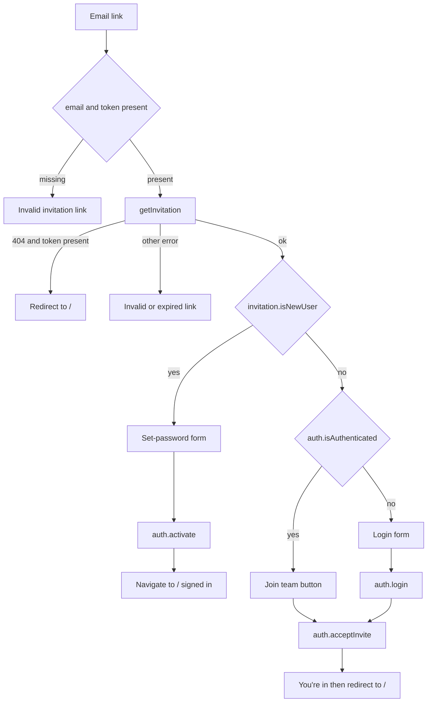
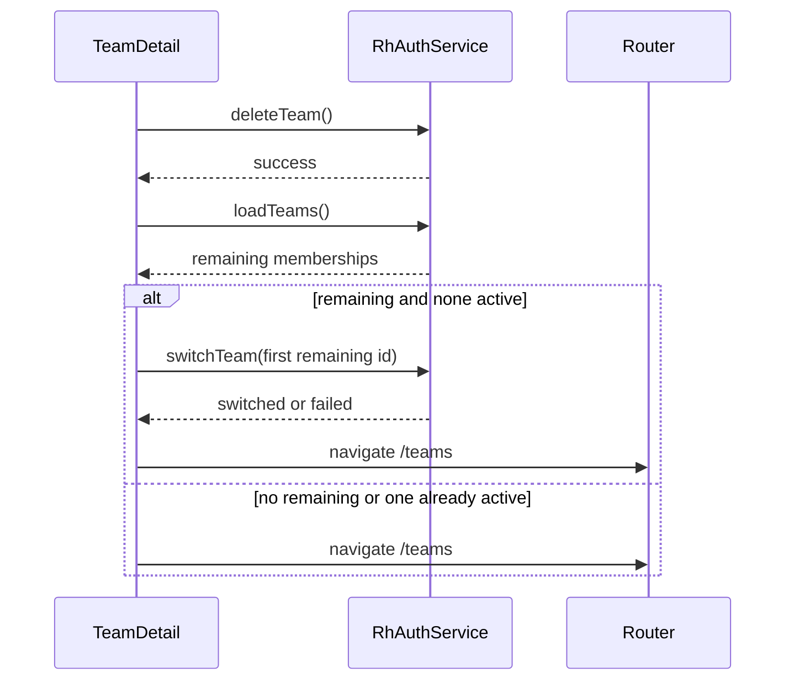

# Teams, Invitations, and Account Workflows

This page covers the user-facing workflows for joining a team from an invitation email, switching the active team, managing members and pending invitations, changing team settings or deleting a team, and editing the signed-in account's profile and password.

Routing and guard placement for these surfaces are documented in [Routing and Guards](../architecture/routing-and-guards.md). The user, team, membership, and invitation shapes live in [Domain Model](../concepts/domain-model.md). A blocked user may hit the [Consents Gate](../concepts/consents-gate.md) in the middle of invitation acceptance; that interaction is called out below. Auth entry flows are in [Auth Flows](auth-flows.md).

## Invitation acceptance

### Two entry paths, one component

The service invitation email links a **new user** to `/auth/activate?email=...&token=...` and an **existing user** to `/invitations/accept?email=...&token=...`. Both paths load the same `Accept` component (`src/app/pages/invitations/accept/accept.ts`) and both are **unguarded** — the invitee may be signed out, signed in, or have no account yet. The routes are registered only when `environment.features.teamInvitations` is enabled.

Keep both entry path names whenever this flow is described: `/auth/activate` (new user) and `/invitations/accept` (existing user).

The component reads `email` and `token` from the query string. Missing either parameter renders "Invalid invitation link" without calling the API.

### Load-time behavior

Because the route has no guard, the Accept constructor performs the session and invitation work that guards normally own:

- If `getToken()` is truthy, it calls `auth.checkSession()` so a user who is already signed in (for example after returning from the consents gate) sees the "Join team" UI rather than a login form.
- It then fetches the invitation with `auth.getInvitation(email, token)`.
- If that call returns **404 while a token is present**, the component redirects to `/` instead of showing an error. This is the revisited-link case: after a consents-gate reload the invitation may already have been accepted, and a signed-in user belongs in the app, not on "invalid link".
- Other failures surface a user-facing error (see [Errors](#errors)).

Invitation acceptance branches on the two email entry paths, unified in one unguarded component.

### Three branches

Once `invitation()` is loaded, the template branches in this order: `missingParams` → `loading()` → `done()` → `invitation()` present, then:

1. **New user (`inv.isNewUser`)** — "Join {teamName}" set-password form (minimum 8 characters). Submitting calls `auth.activate({ email, token, password })`, which both activates the account and signs the user in (bearer delivery in the same response — no follow-up token call). The user is navigated to `/`.
2. **Already signed in (`auth.isAuthenticated()`)** — one-click "Join {teamName}" that calls `auth.acceptInvite(token)`. On success the page sets `done` ("You're in"), then navigates to `/` after 1200 ms.
3. **Existing account, signed out** — "Log in to join {teamName}" form. Submitting calls `auth.login(email, password)` and, on success, continues with the same `acceptInvite` path as branch 2.

The form order is part of the contract: a port must reproduce `isNewUser` before the `isAuthenticated()` check, so a signed-in brand-new invitee still sets a password rather than one-click joining.

### Errors

| Status / case | User-facing meaning |
|---|---|
| Missing `email` or `token` | "Invalid invitation link" (no API call) |
| `404` from `getInvitation` while `getToken()` is truthy | Silent redirect to `/` |
| `404` otherwise (including from `activate` / `acceptInvite`) | "This invitation is invalid or has expired." |
| `401` from login or activate | "Invalid password." |
| Other | Service `message`, or "Something went wrong. Please try again." |

The error branch of the page renders a non-dismissible paragraph, not the shared alert, so a dismiss cannot leave the page empty.

## Teams

Authenticated team surfaces (`/teams`, `/teams/new`, `/teams/:id`) are children of the guarded shell. See [Routing and Guards](../architecture/routing-and-guards.md).

### List and switch

`Teams` (`src/app/pages/teams/teams.ts`) lists `auth.teams()` after `auth.loadTeams()`. Opening a row:

- If the team is already **active**, navigates straight to `/teams/:id`.
- Otherwise calls `auth.switchTeam(team.id)` first. While the call is in flight the row shows **"Switching…"**; on success the user is navigated to the new team's detail page, on failure the indicator clears and the user stays on the list.

Switching updates the active team context in the session (the shell's account menu shows `Team: {active team name}`). There is no separate team-switcher widget on this page: switching happens by opening a non-active team from the list.

`NewTeam` (`src/app/pages/teams/new/new-team.ts`) creates a team with `auth.createTeam(teamName)` and navigates back to `/teams` on success.

### Members

`TeamDetail` (`src/app/pages/teams/detail/team-detail.ts`) loads the team membership from `auth.teams()` by route param and the roster with `auth.listTeamMembers()`.

Owner-only member actions (`isOwner()` is `team()?.role === 'owner'`):

- **Change role** between `member` and `owner` via `auth.updateMemberRole(email, role)`. No-op if the role is unchanged. The row is disabled while `memberActionPending()` matches that email.
- **Remove** via `auth.removeMember(email)`, only after an inline "Remove?" → Yes/No confirmation (`removingMemberEmail`). Success drops the row locally.

The signed-in user's own row (`member.email === auth.user()?._id`) is **not** offered the role select or Remove — it shows the role only. Owners cannot remove or demote themselves from this UI.

### Invitations

Owner-only invite form (`inviteForm`: required email, role `member` or `owner`) calls `auth.invite(email, role)`.

- Success resets the form to `role: 'member'` and shows "Invitation sent!".
- **HTTP 409** is mapped to "This person is already a member of your team." Other failures show the service message.

Pending invitations come from `auth.listInvitations()`. Each row can be **resent** with `auth.resendInvite(email)`.

Resend is subject to a **5-minute cooldown** (`TeamDetail.RESEND_COOLDOWN_MS`). The countdown:

- is seeded from each pending invitation's last send (`createdAt` on non-expired invites, via `withLastSends`);
- updates from `resendInvite` success with the same timestamp used for the cooldown, so the label starts at a clean 5m;
- drives the button label **Wait {n}m** while cooling down and **Resend** when allowed;
- is kept live by a `now` signal that ticks every 30 seconds — `Date.now()` is not reactive and this app is zoneless, so a static clock would freeze the label and leave the button disabled after expiry.

If the service refuses a resend (too many resends or too soon), the reason is shown in `resendError`. Expired invites are marked "· expired" in the list.

### Team settings and deletion

Owner-only **Team settings** form (`name` required, `description` optional) saves with `auth.updateTeam({ name, description })`. Editing the form clears the "Team updated!" flag.

The **danger zone** deletes the team:

1. "Delete team" opens an inline `role="alertdialog"` confirmation ("Are you sure?" / "Yes, delete" / "Cancel").
2. `auth.deleteTeam()` runs; failures show "Could not delete the team." or the service message.
3. On success the component reloads memberships with `auth.loadTeams()`.
4. If teams remain and **none is active**, it calls `auth.switchTeam(remaining[0].id)` so the user is not stranded without a team context; switch success and failure both continue to `/teams`.
5. Otherwise it navigates to `/teams`.

The UI states deletion is only possible while no other members remain; the backend enforces that constraint.

Team deletion recovery: reload teams, then auto-switch to the first remaining membership when no team is active.

## Account profile and password

`Account` (`src/app/pages/account/account.ts`) is the signed-in user's settings page. The email field is read-only (`auth.user()?._id`).

### Profile

`profileForm` holds `firstName` and `lastName` (both required) and **starts disabled**. `ngOnInit` subscribes to `valueChanges` before `patchValue`, then calls `auth.checkSession()` and patches from `user.profile.name` / `user.profile.surname`. The form is enabled only after the session load, so the user cannot edit against stale values; a fresh success banner cannot survive the initial patch because edit clears `profileSaved`.

Save calls `auth.updateProfile({ firstName, lastName })`, then marks the form pristine and shows "Profile updated!".

### Change password

`passwordForm`:

- `currentPassword` is **not** required at the form level. Accounts that signed up via OAuth may never have set a password; the backend verifies it only when the account has one (`PATCH /auth/change-password`), so leaving it blank is valid for those accounts and rejected as "Invalid current password" otherwise. When the user has linked OAuth providers (`socialAuths` on the raw `/users/me` payload), the UI shows "Leave blank if you've never set a password."
- `newPassword` is required, minimum 8 characters.

Save calls `auth.changePassword(currentPassword, newPassword)`, then resets both fields and shows "Password changed!". Edits clear the saved flag.

## Error and success signals

These pages keep transient outcomes in signals that the templates can dismiss (`error`, `inviteSent`, `inviteError`, `resendSuccessEmail`, `resendError`, `teamSaved`, `teamError`, `deleteError`, `profileSaved`, `profileError`, `passwordSaved`, `passwordError`). Forms that load existing data subscribe to `valueChanges` before the initial write so the first patch does not leave a stale success message on screen.

## Focused tests and manual checks

Component specs under `src/app/pages/invitations/accept/accept.spec.ts` and `src/app/pages/account/account.spec.ts` are creation smoke tests only; team pages have no dedicated specs. The behavior above is covered by the hand checklist in `TEST-CASES.md`, notably:

- New-user `/auth/activate` set-password → straight-in login, with `PATCH /auth/activate?delivery=body` returning `access_token` and **no** follow-up `POST /token`.
- Existing-user `/invitations/accept` login-then-accept and already-signed-in accept.
- Invalid/expired invitation link copy.
- Team switch updates the active context immediately (`POST /auth/switch-team?delivery=body` returns the new token).

See [Testing Guidance](../testing/guidance.md) for the surrounding harness.
